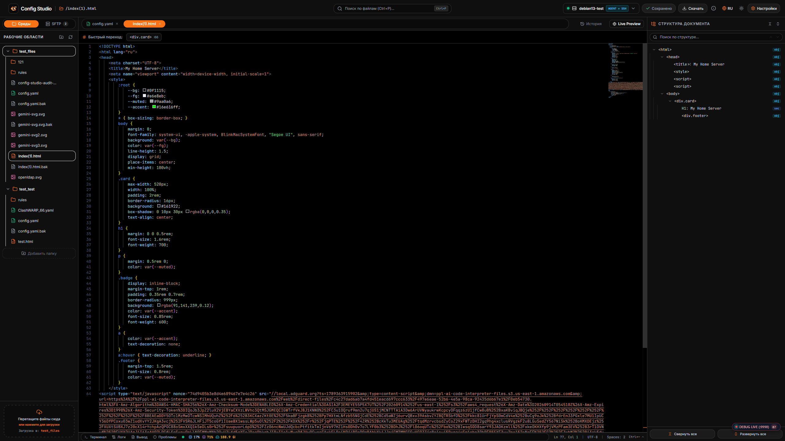
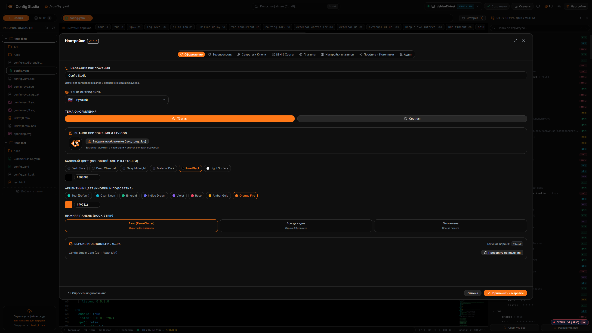

# Config Studio 🚀

[](https://github.com/config-studio/config-studio/actions/workflows/build.yml)
[](https://github.com/config-studio/config-studio/releases)
[](https://opensource.org/licenses/MIT)

> [🇷🇺 Описание на русском](#-config-studio-на-русском) | [🇬🇧 English version below](#-config-studio-english)

---

## 🇷🇺 Config Studio (На русском)

Современная, производительная веб-среда для редактирования конфигурационных файлов и управления серверной инфраструктурой со встроенным ядром **Monaco Editor** (как в VS Code), интерактивной картой структуры документа (**AST Map**), нативным терминалом **SSH & SFTP**, хранилищем секретов **Core Vault** и расширяемой модульной архитектурой плагинов.

Поставляется в виде **единого бинарного файла** под **Linux** и **Windows** без необходимости устанавливать Node.js, базы данных или другие внешние зависимости.

### 📸 Скриншоты интерфейса


*Главное рабочее пространство: Monaco Editor с подсветкой синтаксиса, навигация по вкладкам, AST-дерево структуры документа, переключатель узлов флота и системная телеметрия.*


*Панель настроек: кастомизация палитры (Base & Accent), безопасность и Trusted Proxies, хранилище секретов Core Vault, каталог плагинов и управление языковыми пакетами.*

---

### ✨ Ключевые возможности

- **Ядро редактора Monaco Editor:**
  - Полноценный движок VS Code с подсветкой синтаксиса YAML, JSON, TOML, INI, Shell, Markdown, Dockerfile и др.
  - Автоматическая адаптация размера редактора при изменении ширины панелей.
  - Горячие клавиши, множественные курсоры, автодополнение и форматирование.
- **Интерактивная карта структуры документа (AST Map):**
  - Иерархическое дерево с бейджами типов данных (`Object`, `List`, `String`, `Boolean`, `Number`, `Section`).
  - Мгновенный переход к строке кода кликом по элементу дерева.
  - Поиск по структуре с подсчетом совпадений (`X из Y`) и стрелками навигации.
  - Кнопки «Свернуть все» и «Развернуть все».
  - Плавное изменение ширины панели перетаскиванием (двойной клик сбрасывает на 320px, запоминает ширину в `localStorage`).
  - Облако тегов корневых разделов под вкладками с поддержкой горизонтальной прокрутки.
- **Мультивкладочность и управление файлами:**
  - Открытие нескольких файлов во вкладках с индикатором несохраненных изменений.
  - Диалоговое окно подтверждения закрытия при наличии несохраненных правок.
  - Быстрый переход и поиск файлов (**Ctrl+P**).
  - Проводник файлов: создание, удаление, переименование файлов и папок, Drag-and-drop загрузка.
  - Свойства файла: расчет SHA-256 хеша с кнопкой копирования, статистика по строкам и символам.
  - Локальная история правок сессии с просмотром diff и восстановлением любой версии.
- **Нативный SSH и SFTP в ядре (Core SSH/SFTP):**
  - Интерактивный терминал xterm.js в нижней док-панели (`BottomDockStrip`) с поддержкой множественных сессий и автопереподключения.
  - Двухвкладочный сайдбар проводника: быстрое переключение между локальными «Рабочими областями» и удаленными «SFTP» серверами.
  - Прямое редактирование удаленных файлов в Monaco Editor с автосохранением на сервер (`Ctrl+S`).
- **Time Machine (Визуальное версионирование и откат в 2 клика):**
  - Автоматические персистентные снимки при каждом сохранении файла.
  - Monaco DiffEditor для side-by-side сравнения текущей версии с историей (`Alt+H`) и откат изменений в 2 клика.
- **Мульти-рабочие области ядра (Multi-Root Workspaces & `workspaces.yaml`):**
  - Подключение нескольких папок и дисков в единое дерево проводника с защитой выхода за границы (`SafePath`).
- **Аппаратная телеметрия ядра (SysInfo):**
  - Индикатор `SysInfoBar` в строке состояния (нагрузка CPU %, физическая RAM, свободное место на диске, аптайм).
  - Детальное модальное окно диагностики `SysInfoModal` и автоматический шеринг метрик с удаленными узлами флота.
- **Безопасность, Trusted Proxies и SSO:**
  - Встроенный экран авторизации (парольная защита сессий).
  - Поддержка доверенных обратных прокси и подсетей CIDR (`trustedProxies`).
  - Сквозная авторизация Forward Auth (`X-Forwarded-User`) для интеграции с Traefik, Authelia, Authentik.
  - Отключаемый REST API с генерацией секретных ключей `X-API-Key`.
- **Хранилище секретов Core Vault:**
  - Безопасное централизованное хранилище чувствительных данных (пароли, SSH-ключи, API-токены).
  - Автоматическая генерация slug ID из названия, категории и области применения.
- **Потоковое структурированное логирование (Structured Logs Streaming):**
  - Мониторинг системных событий и логов плагинов через API `/api/logs/stream`.
  - Фильтрация по уровням важности (INFO/WARN/ERROR), подсистемам и полнотекстовый поиск.
- **Модульная система плагинов (Plugin Engine v2.3.6+):**
  - **Бинарный MRS-контейнер `.cspkg`**: сверхбыстрое чтение пакетов на лету прямо из памяти с криптографической проверкой SHA-256.
  - **Split-Webview**: нативная интеграция пользовательских веб-интерфейсов расширений рядом с редактором (`registerSplitWebview`) с сохранением скролла.
  - **Синхронизация каталога в реальном времени**: одновременное обновление локальных плагинов и проверка внешних источников GitHub в один клик.
  - **Вынесенные локализации (`local.json`)**: поддержка мультиязычности без необходимости пересборки JavaScript.
  - **Zero-Binary Registry**: каталог плагинов без бинарных файлов в git-репозитории, распространение исключительно через GitHub Releases.
- **Официальные расширения экосистемы:**
  - 🖥️ **[config-studio-servers](https://github.com/config-studio/config-studio-servers)** (v1.5.2): «Серверы и Флот» — централизованный инвентарь `servers.yaml`, селектор узлов в шапке, 1-Click установка демона, LAN Discovery, поставка агентов внутри `.cspkg` и защищенное хранение ключей в Core Vault.
  - 🌐 **[config-studio-web-devkit](https://github.com/config-studio/config-studio-web-devkit)** (v1.4.0): **Живой посимвольный рендеринг в реальном времени (Real-Time Live Preview)** без необходимости сохранения, сохранение позиции скролла (Zero-Jitter), симуляция вкладки Chrome, сервер :8085, AST-структура HTML/PHP.
  - 🚦 **[config-studio-traefik](https://github.com/config-studio/config-studio-traefik)** (v1.2.0): Мониторинг маршрутов, сервисов, TLS-сертификатов и валидация конфигураций Traefik.
  - 🌍 **Официальные языковые пакеты:**
    - 🇷🇺 **[config-studio-lang-ru](https://github.com/config-studio/config-studio-lang-ru)** (v1.1.0): Русский интерфейс
    - 🇬🇧 **[config-studio-lang-en](https://github.com/config-studio/config-studio-lang-en)** (v1.1.0): English UI
    - 🇩🇪 **[config-studio-lang-de](https://github.com/config-studio/config-studio-lang-de)** (v1.1.0): Deutsche Benutzeroberfläche
- **Ресурсы для разработчиков:**
  - 🧩 **[Официальный реестр плагинов](https://github.com/config-studio/config-studio-plugins)**
  - 📚 **[Документация по API и разработке плагинов](https://github.com/config-studio/config-studio-plugin-docs)**
  - 📦 **[Шаблон нового плагина](https://github.com/config-studio/config-studio-plugin-template)**

---

### 🚀 Быстрый запуск

#### Скачивание готового бинарника
Скачайте бинарник для вашей системы со страницы **[GitHub Releases](https://github.com/config-studio/config-studio/releases)**:
- **Windows (amd64)**: `config-studio-windows-amd64.exe`
- **Linux (x86_64 / amd64)**: `config-studio-linux-amd64`
- **Linux (ARM64)**: `config-studio-linux-arm64`

#### Запуск на Linux:
```bash
chmod +x config-studio-linux-amd64
./config-studio-linux-amd64 --port 8080 --workdir /etc/yaml-configs
```

#### Автоустановка в качестве службы (Linux systemd / OpenRC):
Бинарник умеет сам устанавливать и настраивать системный демон:
```bash
# Установка сервиса (автоматически определит systemd или OpenRC):
sudo ./config-studio-linux-amd64 -install

# Удаление сервиса:
sudo ./config-studio-linux-amd64 -uninstall
```

#### Запуск на Windows:
```powershell
.\config-studio-windows-amd64.exe -port 8080 -workdir C:\configs
```
После запуска откройте в браузере: `http://localhost:8080` (или `http://<IP-сервера>:8080`).

---

### 🛠️ Сборка из исходников

#### Требования:
- **Go 1.22+**
- **Node.js 20+** & **npm**

```bash
# 1. Клонирование репозитория
git clone https://github.com/config-studio/config-studio.git
cd config-studio

# 2. Сборка веб-интерфейса
cd web
npm install
npm run build
cd ..

# 3. Компиляция бинарника
# Для Linux:
CGO_ENABLED=0 GOOS=linux GOARCH=amd64 go build -ldflags="-s -w" -o bin/config-studio ./cmd/server

# Для Windows:
go build -ldflags="-s -w" -o bin/config-studio.exe ./cmd/server
```

---

### ⚙️ Флаги запуска и переменные окружения

| Флаг | Переменная окружения | По умолчанию | Описание |
|---|---|---|---|
| `--port` | `CONFIG_PORT` | `8080` | Порт HTTP сервера |
| `--workdir` | `CONFIG_WORKDIR` | `./data/configs` | Папка с редактируемыми конфигами |
| `--data` | `CONFIG_DATADIR` | `./data` | Папка для настроек, логотипов и сессий |
| `--auth-user` | `CONFIG_AUTH_USER` | `""` | Логин базовой авторизации |
| `--auth-pass` | `CONFIG_AUTH_PASS` | `""` | Пароль авторизации |
| `-install` | — | `false` | Установить как службу systemd/OpenRC (Linux) |
| `-uninstall` | — | `false` | Удалить службу systemd/OpenRC (Linux) |

---
---

<a name="english-version"></a>
## 🇬🇧 Config Studio (English)

Modern, high-performance web-based workspace for editing configuration files and managing server infrastructure powered by **Monaco Editor** (VS Code engine), interactive document outline (**AST Map**), native **SSH & SFTP** terminals, **Core Vault** secrets manager, and an extensible plugin ecosystem.

Shipped as a **single standalone portable binary** for **Linux** and **Windows** with zero external runtime dependencies (no Node.js or databases required).

### 📸 Screenshots


*Main Workspace: Monaco Editor with syntax highlighting, multi-tab navigation, AST structure outline, fleet server switcher, and SysInfo hardware telemetry.*


*Settings & Control Center: theme & branding (Base & Accent), security & Trusted Proxies, Core Vault secrets manager, plugins catalog, and language packs.*

---

### ✨ Features

- **Monaco Editor Core:** Full VS Code editing experience with syntax highlighting for YAML, JSON, TOML, INI, Shell, Markdown, and Dockerfile.
- **Interactive Structure Outline (AST Map):**
  - Hierarchical tree navigation with data type badges (`Object`, `List`, `String`, `Boolean`, `Number`, `Section`).
  - Instant line jump on tree node click.
  - Search within outline with match counter (`X of Y`) and navigation arrows.
  - One-click "Collapse All" / "Expand All" controls.
  - Draggable resizable panel width (double-click resets to default 320px, state remembered in `localStorage`).
  - Root section quick-jump tag cloud with horizontal scroll support.
- **Multi-Tab File Management:**
  - Tabbed editing with dirty indicators.
  - Unsaved changes confirmation modal.
  - Quick File Switcher (**Ctrl+P**).
  - File Explorer with folder navigation, inline create/rename/delete, and drag-and-drop file upload.
  - File properties with SHA-256 calculation, one-click clipboard copy, and line/char statistics.
  - Session edit history with visual diff preview and single-click revision rollback.
- **Native Core SSH & SFTP:**
  - Interactive xterm.js terminal in persistent bottom dock (`BottomDockStrip`) with multi-session support and auto-reconnect.
  - Dual-tab file sidebar: seamless switching between local "Workspaces" and remote "SFTP" servers.
  - Direct remote editing in Monaco Editor with automatic remote saves on `Ctrl+S`.
- **Time Machine (Visual History & 2-Click Rollback):**
  - Persistent automatic snapshots created upon every file save.
  - Monaco DiffEditor for side-by-side delta inspection (`Alt+H`) with single-click revision rollback.
- **Multi-Root Workspaces (`workspaces.yaml`):**
  - Mount multiple local/remote directory roots into a unified tree explorer with boundary-safe path enforcement (`SafePath`).
- **Hardware Telemetry & Node Monitoring (Core SysInfo):**
  - Dynamic `SysInfoBar` status bar widget showing CPU load %, physical RAM, disk usage, and system uptime.
  - Comprehensive `SysInfoModal` diagnostics modal with live telemetry sharing from remote fleet nodes.
- **Security, Trusted Proxies & SSO:**
  - Built-in session authentication.
  - Support for reverse proxies and CIDR subnets (`trustedProxies`).
  - Forward Auth pass-through (`X-Forwarded-User`) for Traefik, Authelia, Authentik.
  - Disableable REST API with secret `X-API-Key` generation.
- **Core Vault Secrets Management:**
  - Secure centralized vault for confidential data (passwords, SSH keys, API tokens).
  - Automatic slug ID generation from title, category, and scope.
- **Structured Log Streaming:**
  - Live system and plugin event streaming via `/api/logs/stream`.
  - Severity level filtering (INFO/WARN/ERROR), subsystem tagging, and full-text search.
- **Modular Plugin System (Plugin Engine v2.3.6+):**
  - **Binary MRS Containers (`.cspkg`)**: Ultra-fast in-memory package loading verified by cryptographic SHA-256 checksums.
  - **Split-Webview**: Native side-by-side webview integration (`registerSplitWebview`) with scroll retention.
  - **Real-Time Catalog Sync**: Simultaneous local plugin reload and remote GitHub catalog sync in one click.
  - **Externalized Localizations (`local.json`)**: Multi-language support without re-compiling JavaScript.
  - **Zero-Binary Registry**: Catalog without binaries tracked in git, distributed exclusively via official GitHub Releases.
- **Official Ecosystem Plugins:**
  - 🖥️ **[config-studio-servers](https://github.com/config-studio/config-studio-servers)** (v1.5.2): "Servers & Fleet Manager" — centralized `servers.yaml` inventory, universal header switcher, 1-Click daemon auto-onboarding, LAN agent discovery, embedded agent delivery, and Core Vault security.
  - 🌐 **[config-studio-web-devkit](https://github.com/config-studio/config-studio-web-devkit)** (v1.4.0): **Real-Time Live Keystroke Preview** without saving, Zero-Jitter scroll retention, Chrome tab simulation, embedded :8085 web server, HTML/PHP AST outline.
  - 🚦 **[config-studio-traefik](https://github.com/config-studio/config-studio-traefik)** (v1.2.0): Traefik reverse proxy routes, services, TLS certificates monitoring, and config validation.
  - 🌍 **Official Language Packs:**
    - 🇷🇺 **[config-studio-lang-ru](https://github.com/config-studio/config-studio-lang-ru)** (v1.1.0): Russian UI
    - 🇬🇧 **[config-studio-lang-en](https://github.com/config-studio/config-studio-lang-en)** (v1.1.0): English UI
    - 🇩🇪 **[config-studio-lang-de](https://github.com/config-studio/config-studio-lang-de)** (v1.1.0): German UI
- **Developer Ecosystem:**
  - 🧩 **[Official Plugin Registry](https://github.com/config-studio/config-studio-plugins)**
  - 📚 **[Plugin Development API & Guides](https://github.com/config-studio/config-studio-plugin-docs)**
  - 📦 **[Plugin Boilerplate Template](https://github.com/config-studio/config-studio-plugin-template)**

---

### 🚀 Quick Start

#### Download Pre-compiled Binary
Grab the latest release from **[GitHub Releases](https://github.com/config-studio/config-studio/releases)**:
- **Windows (amd64)**: `config-studio-windows-amd64.exe`
- **Linux (x86_64 / amd64)**: `config-studio-linux-amd64`
- **Linux (ARM64)**: `config-studio-linux-arm64`

#### Running on Linux:
```bash
chmod +x config-studio-linux-amd64
./config-studio-linux-amd64 --port 8080 --workdir /etc/yaml-configs
```

#### Self-Installing as a Service (Linux systemd / OpenRC):
```bash
# Auto-detects systemd or OpenRC and registers system daemon:
sudo ./config-studio-linux-amd64 -install

# To uninstall service:
sudo ./config-studio-linux-amd64 -uninstall
```

#### Running on Windows:
```powershell
.\config-studio-windows-amd64.exe -port 8080 -workdir C:\configs
```
Open your browser at `http://localhost:8080`.

---

### 🛠️ Building from Source

#### Prerequisites:
- **Go 1.22+**
- **Node.js 20+** & **npm**

```bash
# 1. Clone repository
git clone https://github.com/config-studio/config-studio.git
cd config-studio

# 2. Build Web Frontend
cd web
npm install
npm run build
cd ..

# 3. Build Go Binary
# For Linux:
CGO_ENABLED=0 GOOS=linux GOARCH=amd64 go build -ldflags="-s -w" -o bin/config-studio ./cmd/server

# For Windows:
go build -ldflags="-s -w" -o bin/config-studio.exe ./cmd/server
```

---

### ⚙️ Command Line Flags & Environment Variables

| Flag | Environment Variable | Default | Description |
|---|---|---|---|
| `--port` | `CONFIG_PORT` | `8080` | HTTP port to listen on |
| `--workdir` | `CONFIG_WORKDIR` | `./data/configs` | Working directory containing config files |
| `--data` | `CONFIG_DATADIR` | `./data` | Directory for persistent settings and icons |
| `--auth-user` | `CONFIG_AUTH_USER` | `""` | Basic Auth username (disabled if empty) |
| `--auth-pass` | `CONFIG_AUTH_PASS` | `""` | Basic Auth password |
| `-install` | — | `false` | Install as systemd/OpenRC service (Linux) |
| `-uninstall` | — | `false` | Uninstall systemd/OpenRC service (Linux) |

---

## 📄 License
MIT License.
