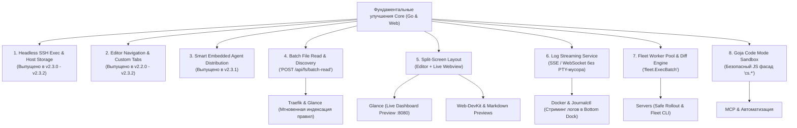

# Config Studio Roadmap & Master Architecture Plan 🗺️

План развития экосистемы **Config Studio** и официальных плагинов.

> **Главный регламент разработки:**
> 1. **Сперва ядро (Core First):** Сначала реализуются и тестируются фундаментальные механизмы ядра редактора, валидации и точек расширения.
> 2. **Предварительное обсуждение:** Перед реализацией **каждой отдельной функции** мы подробно обсуждаем ее UX/UI, структуру данных и сценарии использования. Только после явного утверждения пишется код.
> 3. **Изолированный репозиторий для каждого расширения (One Repo Per Plugin):** Каждый официальный плагин экосистемы Config Studio (`config-studio-servers`, `config-studio-traefik`, `config-studio-web-devkit` и др.) разрабатывается, версионируется и сопровождается в **отдельном самостоятельном GitHub-репозитории** со своим кодом, тестами и релизным циклом, а центральный репозиторий `config-studio-plugins` выступает реестром пакетов и точкой дистрибуции `.cspkg`.
> 4. **Инженерная дисциплина (/ub-mode):** Вся разработка и модификация кодовой базы строго следует циклу: *First Make it Work* (Laziness Protocol: одно решение в одном месте, TDD, Boundary Discipline, Type System Discipline, Idempotence, Subtract Before You Add), *Then Make it Right* (устранение первопричин, дробление функций, удаление мертвого кода), *Follow Practice* (Keep a Log, Worktree Cleanup, Commit often with why/what/proof).
> 5. **Регламент ведения Roadmap (Roadmap Clean-State Discipline):** Секции текущего спринта и планируемых плагинов («В РАБОТЕ» / «ПЛАНИРУЕМЫЕ ПЛАГИНЫ») должны содержать **строго невыполненные задачи и бэклог (`- [ ]`)**. Как только этап или функция полностью завершена, она **всегда переносится вниз под спойлер (`

...
`) в архив выполненных этапов (Released)**. Верхний план никогда не должен захламляться выполненными чекбоксами.
> 6. **Обязательный релиз плагинов через GitHub Workflow (CI/CD Automated Releases):** Каждое расширение должно компилироваться и выпускаться строго через GitHub Actions Workflow (`.github/workflows/release.yml`) при пуше тега версии (`v*`) или `workflow_dispatch`. Workflow автоматически запускает unit-тесты, собирает `main.js`, упаковывает бинарный пакет `.cspkg`, генерирует SHA-256 чексуммы и публикует официальный GitHub Release с прикрепленными артефактами. Создание всех новых расширений выполняется на базе официального репозитория-шаблона `config-studio-plugin-template`.
> 7. **Инкрементальное версионирование по пунктам Roadmap (Sub-versioning per Item):** Начиная с релиза **v2.3.0**, за каждый выполненный функциональный пункт из `Core Evolution Roadmap` выпускается отдельная подверсия ядра (**v2.3.1**, **v2.3.2**, **v2.3.3** и т.д.) с немедленным тестированием, обновлением архива и сборкой бинарников.

---

## 🎯 ТЕКУЩИЙ ЭТАП / В РАБОТЕ (Current Sprint: v2.3.3)

### 🎯 Core Evolution (Спринт v2.3.3)
- [ ] **1. Пакетное чтение файлов каталога (Batch File Read & Discovery)**:
  - [ ] Пакетное чтение файлов каталога: `POST /api/fs/batch-read` и `POST /api/sftp/batch-read` с поддержкой glob-масок (`rules/mw-*.yml`) для быстрой индексации без множественных сетевых запросов (необходимо для кросс-файловой навигации Traefik, Glance и инспекторов).

### 💡 Отложенные задачи и бэклог (Backlog)
- [ ] **Глобальный реестр горячих клавиш плагинов**: `window.ConfigStudio.registerShortcut(key, handler)` для вызова плагинных действий с клавиатуры (отложено до расширения каталога плагинов; текущее управление полностью закрывается верхним тулбаром и клавишей `F5`).

---

## 🏗️ ДОРОЖНАЯ КАРТА УЛУЧШЕНИЙ ЯДРА (Core Evolution Roadmap)

Фундаментальные сервисы и точки расширения ядра, создаваемые по принципу *Core First* перед реализацией соответствующих плагинов:

### 1. Пакетное чтение файлов и кросс-файловый поиск (Batch File Read & Discovery)
*Необходимо для: `config-studio-traefik` (Go to Definition), `config-studio-glance` ($include), линтеров и инспекторов.*
- [ ] Пакетное чтение файлов каталога: `POST /api/fs/batch-read` и `POST /api/sftp/batch-read` с поддержкой glob-масок (`rules/mw-*.yml`) для быстрой индексации без множественных сетевых запросов.

### 2. Разделенный экран (Split-Screen Workspace Layout)
*Необходимо для: `config-studio-glance` (Live Dashboard Preview :8080), `config-studio-web-devkit` (Chrome preview), Markdown/HTML превью.*
- [ ] Режим двухпанельного сплита (Editor слева, Webview / Iframe справа) с перетаскиваемым разделителем в `App.tsx`.
- [ ] Плагинное API: `window.ConfigStudio.registerSplitWebview({ id, title, url, refreshOnSave?: boolean })`.

### 3. Структурированный потоковый логгер (Log Streaming Service)
*Необходимо для: `config-studio-journal` (journalctl -f), `config-studio-docker` (compose logs -f).*
- [ ] Потоковый канал логов на бэкенде (Server-Sent Events / WebSocket) без ANSI-мусора PTY.
- [ ] Компонент Log Viewer в `@config-studio/ui` с поиском, паузой автоскролла и цветовой дифференциацией уровней (ERROR/WARN/INFO).

### 4. Параллельный воркер-пул флота и Diff Engine
*Необходимо для: `config-studio-servers` (Safe Rollout).*
- [ ] Воркер-пул параллельного исполнения `fleet.ExecBatch(hostIds, cmd, concurrencyLimit)` в пакете `internal/fleet`.
- [ ] Универсальный эндпоинт `POST /api/fs/diff` для предпросмотра различий Diff & Approve между локальным файлом и файлом на сервере.

### 5. Эфемерная песочница Goja (Code Mode Sandbox)
*Необходимо для: `config-studio-mcp & Code Mode Engine`.*
- [ ] Встраивание `github.com/dop251/goja` в пакет `internal/sandbox` с нулевым потреблением heap в покое.
- [ ] Безопасный фасад ядра `cs.*` (`cs.servers`, `cs.ssh`, `cs.fs`, `cs.vault`) с лимитом времени (10s) и глубины стека.

---

## 🖧 ПЛАНИРУЕМЫЕ ПЛАГИНЫ (Phase 2 Breakdown)

### 🖧 ФАЗА 2A: Системное администрирование и инфраструктура (Sysadmin & Fleet)
- [ ] **config-studio-servers («Серверы и Флот» — этап 5: Safe Rollout)**:
  - [ ] **Массовая раскатка конфигов (Safe Rollout)**:
    - Сводный предпросмотр Diff & Approve перед применением файла на выбранную группу узлов.
    - Canary-first раскатка (1 тестовый узел -> проверка валидатором / health check -> раскатка на остальные).
    - Автоматический план отката (1-Click Rollback) при сбое канарейки.
    - Fleet CLI: выполнение сервисных команд (`systemctl restart`, `docker compose pull`) на группе узлов со сводным терминальным выводом в нижнем доке.

### 🎯 ЦЕЛЕВЫЕ СТЕКОВЫЕ ПЛАГИНЫ (Targeted Stack Plugins: Doctor + Blueprints Inside)
- [ ] **config-studio-docker**:
  - [ ] Типовые поля настройки и конструктор Compose-файлов.
  - [ ] Встроенные шаблоны (PostgreSQL + Redis + App, Traefik, Backup).
  - [ ] Pre-Save валидация на удаленном хосте (`docker compose config`) перед записью.
  - [ ] Прямые кнопки тулбара `Compose Up -d`, `Down`, `Pull`.
  - [ ] Стриминг логов контейнеров в реальном времени в нижний док.
  - [ ] Dashboard статусов контейнеров и портов.
- [ ] **config-studio-nginx**:
  - [ ] Конструктор блоков `server`, `location`, `proxy_pass`.
  - [ ] Шаблоны Best-Practice (Reverse Proxy с WebSocket, кэшированием и SSL).
  - [ ] Удаленная проверка синтаксиса `nginx -t` перед сохранением или SFTP-отправкой.
  - [ ] Включение/выключение сайтов `sites-available` ➔ `sites-enabled` в 1 клик.
  - [ ] Монитор срока годности SSL/TLS сертификатов.
- [ ] **config-studio-wireguard**:
  - [ ] Визуальный генератор конфигураций `wg0.conf` и клиентских пиров.
  - [ ] Встроенный генератор ключевых пар WireGuard (Curve25519) и QR-кодов.
  - [ ] Индикатор активного рукопожатия (Handshake) и переданного трафика.
- [ ] **config-studio-singbox**:
  - [ ] Интеллектуальный парсер и визуальный редактор JSON/JSON5 структуры.
  - [ ] Конструктор входящих (`inbounds`) и исходящих (`outbounds`) узлов.
  - [ ] Визуальный роутинг правил (`route.rules`).
- [ ] **config-studio-glance**:
  - [ ] Поддержка многофайловой структуры `$include` (главный конфиг + подкаталоги).
  - [ ] Двухпанельный Split-View с живым предпросмотром дашборда на встроенном веб-сервере Glance.

---

## 🗄️ АРХИВ ВЫПОЛНЕННЫХ ЭТАПОВ (Released)

<b>🚀 Детали релиза v2.3.2: Core Host Storage, Unification, Custom Tabs & Plugin Docs Overhaul (ПОЛНОСТЬЮ РЕАЛИЗОВАНО И ВЫПУЩЕНО В РЕЛИЗ)</b>

- [x] **Централизованное хранилище узлов Core Host Storage (`data/hosts.json`)**:
  - Перенос инвентаря серверов из разрозненных локальных `localStorage` браузера в надежный персистентный Go-бэкенд (`internal/server/hosts.go`).
  - REST API: `GET /api/hosts`, `POST /api/hosts`, `DELETE /api/hosts/:id`.
  - Автоматическая бесшовная миграция старых записей хостов при первом старте.
- [x] **Клиентский сервис `sshHostService` (`sshHosts.ts`)**:
  - Единая точка правды для терминала, SFTP, флота серверов и плагинов.
  - Реактивная подписка на изменения (`subscribe`), кэширование и экспорт в формат OpenSSH (`~/.ssh/config`).
  - Экспорт в глобальный фасад: `window.ConfigStudio.ssh`.
- [x] **Виртуальные пользовательские вкладки (`openCustomTab`)**:
  - Реализован метод `openCustomTab({ path, name, content, language, readOnly, badge, onSave })` для отображения виртуальных документов, Diff-сравнений и сводок в главном таб-баре редактора.
- [x] **Фирменный компонент Dropdown для ванильного JS (`ui.renderDropdown`)**:
  - Реализован `mountDropdown(container, config)` с поддержкой `openUpward`, статусов подключения, бейджей, поиска и программного контроллера `VanillaDropdownController`.
- [x] **Интерактивная витрина дизайн-системы (`config-studio-plugins/ui.html`)**:
  - Модернизирована пропорциональная сетка модальных окон с шагом 20%: `sm (24vw ≥480px)`, `md (32vw ≥540px)`, `lg (45vw ≥500×400px)`, `xl (60vw ≥620×480px)`, `xxl (80vw ≥780×580px)` и `fullscreen (100vw×vh)`.
  - Реализована динамическая кнопка Maximize / Restore (`toggleModalMaximize`) с переключателем `allowMaximize` и мобильной адаптивностью.
  - Интегрированы секции новых компонентов: `ConfirmModal` (варианты danger, warning, primary с имитацией выполнения), `EmptyState` (пустые списки, загрузка со спиннером, сброс фильтров), `SearchInput` (лупа, кнопка очистки ✕, реактивный лог событий), `SectionHeader` (шапки секций с бейджами и переключателями), `ScrollArea` (горизонтальный скролл на колесико мыши без зажатия Shift).
- [x] **Унификация UI и возврат списка плагинов**:
  - Возврат чистого сбалансированного списочного вида на вкладке «Плагины» (`PluginsTab.tsx`) с сохранением всех фильтров и мгновенным откликом.
  - Унификация дизайн-токенов Core Design System v2 в `config-studio-traefik v1.1.1` и `config-studio-web-devkit v1.3.3`.
- [x] **Ревизия режима повышенных привилегий и очистка UI (Privileged Mode Cleanup)**:
  - Удален неиспользуемый декоративный баннер с тумблером «Режим повышенных привилегий («Я знаю, что делаю»)» на вкладке плагинов (`PluginsTab.tsx`), не имевший практического действия в ядре.
  - Устранен вводящий в заблуждение ложный баннер «Управление секретами заблокировано» на вкладке `SecretsTab.tsx` при локальной работе без мастер-пароля; заменен на информационный Callout локального режима.
- [x] **Глобальная синхронизация репозитория документации `config-studio-plugin-docs`**:
  - Полное обновление TypeScript-определений `types/config-studio.d.ts` (14 новых API-методов, полные типы `secrets`, `sysinfo`, `agent`, `ssh`).
  - Актуализация всех 7 глав руководства `docs/`, шаблона `template/` и примеров `examples/`.
  - Все изменения закоммичены и отправлены в `origin/main`.

<b>📦 Детали релиза v2.3.1: Smart Plugin-Embedded Agent Distribution (ПОЛНОСТЬЮ РЕАЛИЗОВАНО И ВЫПУЩЕНО В РЕЛИЗ)</b>

- [x] **Smart Plugin-Embedded Agent Distribution**:
  - Встраивание скомпилированных бинарников удаленного агента `config-studio-agent` внутрь `.cspkg` для архитектур `linux/amd64` и `linux/arm64`.
  - Стриминг `ZIP -> SFTP` напрямую из архива в удаленный файл через `io.Reader` без промежуточной распаковки на диск клиента (чистота системы и обход антивирусных ложных срабатываний).
  - Спецификация секции `agent` в `plugin.json` с двойным версионированием (версия плагина `version: "1.4.0"` и версия бинарника `agent.version: "2.3.0"` с хэшем `commit: "1fe3dc3"`).
  - Защита ядра от ошибки ядра Linux `EXDEV (Invalid cross-device link)` путем размещения временных `.tmp` файлов строго в той же директории, что и целевой бинарник.
  - Механизм ротации с созданием резервной копии `.bak`, проверкой эндпоинта `/api/health` и мгновенным откатом при сбое запуска.
  - Автоматизированная сборка бинарников агента в GitHub Actions репозитория `config-studio`.
  - Релиз плагина `config-studio-servers v1.4.0` со встроенным агентом `v2.3.0`.

<b>🎉 Детали релиза v2.3.0: Core UI Design System v2, Web/SSH Terminal, Headless SSH API & Secrets Types (ПОЛНОСТЬЮ РЕАЛИЗОВАНО И ВЫПУЩЕНО В РЕЛИЗ)</b>

- [x] **Дизайн-система ядра v2 (`@config-studio/ui`)**:
  - Создана и развернута библиотека из 28 готовых компонентов: `Callout`, `IconButton`, `Dropzone`, `Checkbox`, `SplitPanel`, `PillTabs`, `NumberInput`, `StatusBadge`, `StatusDot`, `StatusCard`, `Card`, `Button`, `Input`, `Textarea`, `Modal`, `Dropdown`, `Badge`, `EmptyState` и др.
  - 100% паритетная поддержка светлой и темной тем (Light / Dark) со строгим соблюдением WCAG AAA контрастности.
  - Ликвидировано более 320+ разрозненных захардкоженных классов и самописных стилевых оберток, сокращение бойлерплейта экранов на 35–55%.
- [x] **Встроенный Web/SSH Терминал и SFTP (`xterm.js` + Go PTY Stream)**:
  - Мульти-сессионный терминал в нижнем доке (`BottomDockStrip`) с вкладками сессий, статусными индикаторами подключения и автоподгонкой размера (`@xterm/addon-fit`).
  - Интерактивный лаунчер серверов (`TerminalHostLauncher`) и быстрое подключение в 1 клик.
  - Полноценное управление SSH-хостами: создание, редактирование и безопасное связывание с записями Core Vault (`identityId`).
  - Потоковый бинарный WebSocket-мост между браузером и `golang.org/x/crypto/ssh` с корректной передачей управляющих байт.
  - Модальное окно SFTP отправки (`SftpSendModal`) для выгрузки файлов конфигурации на удаленные серверы.
- [x] **Headless Remote SSH Execution API**:
  - Сервис неинтерактивного исполнения `internal/ssh.ExecuteCommand(ctx, cfg, req)` с чистой сессией без PTY-мусора.
  - REST API `POST /api/ssh/exec` с разделением буферов stdout/stderr, кодами возврата, замером времени и таймаутами.
  - Sudo Elevation Helper: автоматическая подстановка пароля из Core Vault для непривилегированных пользователей.
  - Модульные тесты `internal/ssh/exec_test.go` и `internal/server/ssh_test.go`.
- [x] **Реворк экосистемы плагинов**:
  - Полный рефакторинг экранов плагинов (`PluginsTab`, `PluginSettingsTab`, `PluginSplitPanel`, `PluginConsentModal`) на компоненты `@config-studio/ui`.
- [x] **Категоризация секретов по типам**:
  - Структурирование и фильтрация секретов в реестре «Секреты и Ключи» по типам (`Пароль`, `SSH-ключ`, `API токен`, `Сертификат`).
- [x] **Телеметрия ядра и отладчик**:
  - Реализован `debugRecorder.ts`, бейдж Debug Build и перехват сетевых событий.
- [x] **Развертывание и тестирование**:
  - Скомпилирован и протестирован бинарник `config-studio-debug.exe`, все Go и React тесты пройдены.

<b>🌐 Детали релиза config-studio-traefik v1.1.0: Blueprints, Traefik Doctor и Action Toolbar (ВЫПУЩЕНО В РЕЛИЗ)</b>

- [x] **Каталог рецептов Middleware (Blueprints)**:
  - Интегрирован прямо в модальное окно Мастера («Мастер Traefik Dynamic & Blueprints») в виде двухрежимного переключателя:
    - **Сервис (`ser-*.yml`)**: конструктор роутера, сервиса бэкенда, EntryPoint и привязки мидлварей.
    - **Рецепты Middleware (`mw-*.yml`)**: 7 готовых динамических рецептов лучших практик:
      1. `Security Headers` (HSTS, SAMEORIGIN, nosniff, XSS protection, Referrer-Policy).
      2. `Rate Limit` (защита от DDoS и брутфорса: average, burst, period).
      3. `Basic Auth` (HTTP Basic авторизация с хешами htpasswd).
      4. `IP AllowList` (белый список доверенных CIDR подсетей).
      5. `Redirect Scheme` (постоянный 301 редирект HTTP -> HTTPS).
      6. `Compress` (сжатие ответов Gzip / Deflate).
      7. `CrowdSec Bouncer` (интеграция с CrowdSec для блокировки ботнетов).
  - Интерактивная настройка параметров каждого рецепта и живой предпросмотр YAML в реальном времени.
  - Мгновенное создание файла `rules/mw-<name>.yml`, автоматическая переиндексация и открытие в Monaco Editor с подсветкой.
- [x] **Traefik Doctor & Diagnostics**:
  - Локальный аудит целостности ссылок и коллизий: обнаружение битых связей `UNRESOLVED_MIDDLEWARE`, `UNRESOLVED_SERVICE`, `DUPLICATE_HOST` с кнопкой перехода в файл:строку.
  - Интеграция с Traefik REST API (`/api/version`, `/api/overview`, `/api/rawdata`):
    - Проверка версии и времени работы Traefik.
    - Сводка активных HTTP роутеров, сервисов и мидлварей.
    - Обнаружение ошибок рантайма Traefik (роутеры со статусом `disabled` или ошибками компиляции `err: [...]`).
    - Сверка состояния Traefik в памяти с файлами воркспейса (обнаружение незагруженных конфигураций).
    - Информативная обработка недоступности API с понятными подсказками по включению (`api.insecure=true`).
- [x] **Action Toolbar & Context Menus**:
  - Кнопка тулбара **Traefik Matrix** — быстрый вызов интерактивной матрицы правил.
  - Кнопка тулбара **Traefik Doctor** — вызов диагностического центра в 1 клик.
  - Кнопка тулбара **Dashboard** — переход в Web UI Traefik Dashboard в новой вкладке браузера.
  - Контекстные меню для файлов `.yml`/`.yaml` в дереве и редакторе: Doctor, Dashboard, Wizard, Matrix.
  - Регистрация в Inter-Plugin Service `traefik-manager` (`openDoctor`, `openDashboard`, `openWizard`, `openMatrix`).
- [x] **Автоматизированный релиз v1.1.0**:
  - 31 из 31 unit-тестов успешно пройдены (`npm run test:ts`).
  - Собран бинарный пакет `traefik-1.1.0.cspkg` (37 KB).
  - Опубликован официальный релиз на GitHub Releases через GitHub Actions workflow.
  - Обновлен центральный каталог `config-studio-plugins/registry.json`.

<b>🌐 Детали релиза v2.2-dev: config-studio-traefik v1.0.0 & Core Editor Navigation (ПОЛНОСТЬЮ ПРОТЕСТИРОВАНО И ВЫПУЩЕНО)</b>

- [x] **Core Editor Navigation API & Workspace Synchronization**:
  - Расширен метод `openFile(path, { line, column, highlight })` в Monaco Editor и Plugin SDK.
  - Реализован плавный jump-to-line с импульсной анимацией подсветки строки (`.cs-line-highlight-flash`) для открытых и лениво монтируемых файлов.
  - Устранена рассинхронизация активных воркспейсов: нормализация путей и удаление дублирующихся префиксов (`default:`, `test_test:`) в Go-бэкенде (`ResolveRootAndRel`) и `App.tsx` (`createItem`, `saveFile`, `openFile`, `loadDir`).
  - Добавлена поддержка нормализации алиасов языка (`.yml` ↔ `.yaml`) в реестре `outlineProviders` ядра (`pluginLoader.ts`).
  - В панель `StructureOutline.tsx` добавлены специализированные бейджи типов `Router`, `Service`, `Middleware`.
  - Обновлены официальные определения типов в `config-studio-plugin-docs/types/config-studio.d.ts`.
- [x] **config-studio-traefik v1.0.0 (Все 7 компонентов протестированы и подтверждены)**:
  - **1. Multi-File Directory Provider (`/etc/traefik/rules/`)**: автоматическое сканирование и связывание графа раздельных файлов правил `mw-*.yml` (Middlewares) и `ser-*.yml` (Сервисы и Маршрутизаторы) с точной строчной привязкой.
  - **2. Кросс-файловый IntelliSense & Monaco Autocompletion**: автодополнение доступных мидлварей и сервисов в блоках `middlewares:` и `service:`, поддержка списков `- ` без искажения пробелов, приоритет чистых объявленных имен без избыточного `@file`.
  - **3. Go to Definition с импульсной подсветкой**: переход к строке объявления мидлвари или сервиса (`F12`, клик, контекстное меню `Traefik: Перейти к определению`) с плавной подсветкой строки `.cs-line-highlight-flash` без побочного создания пустых файлов.
  - **4. Матрица правил (Rules Matrix View)**: интерактивная сводная таблица всех роутеров, доменов `Host(...)`, EntryPoints, TLS-резолверов, бэкендов и цепочек мидлварей с поиском, фильтрами («Все», «TLS», «Проблемы») и переходом в файл в 1 клик.
  - **5. Linter целостности ссылок и коллизий**: обнаружение отсутствующих мидлварей (`UNRESOLVED_MIDDLEWARE`), несуществующих бэкендов (`UNRESOLVED_SERVICE`) и дублирующихся хостов (`DUPLICATE_HOST`) с отображением волнистых маркеров ошибок в редакторе Monaco.
  - **6. Мастер создания сервисов (New Service Wizard)**: генерация `ser-<name>.yml` с интерактивным выбором существующих мидлварей без мусорных суффиксов, живым YAML-превью и мгновенным открытием в активном воркспейсе.
  - **7. Иерархический YAML Outline**: специализированное дерево Traefik (🌐 Маршрутизаторы, ⚙️ Сервисы, 🛡️ Middlewares) с бейджами `Router`/`Service`/`Middleware`, поддержкой файлов `.yml`/`.yaml` и точной навигацией по строкам.
  - **8. Упаковка, тестирование и дистрибуция**: 26 из 26 unit-тестов успешно пройдены (`npm run test:ts`), собран пакет `traefik-1.0.0.cspkg` (26 KB, 4 файла), пакет зарегистрирован в `config-studio-plugins/registry.json`.

<b>🚀 Детали релиза v2.1.0: Аппаратная телеметрия и системный монитор</b>

- [x] **Нативный сборщик метрик ядра (Hardware Telemetry Collector)**:
  - Мониторинг CPU (ядра, загрузка %), RAM (total, used, free), дисковых разделов и аптайма.
  - REST API `GET /api/sysinfo` и агентский эндпоинт с поддержкой кросс-серверного проксирования.
  - Плагинное API `window.ConfigStudio.sysinfo`.
- [x] **Интерфейс системного монитора в `config-studio-servers` v1.2.0**:
  - Вкладка «Система» в карточке каждого узла флота.
  - Анимированные мини-индикаторы нагрузки в хедере и карточках флота.

<b>📊 Детали релиза v2.0.0: Единая система аудита и телеметрии</b>

- [x] **Единый структурированный поток `audit.jsonl` (Unified Observability Stream)**:
  - Единый файл журнала без дробления на разрозненные файлы логов.
  - Категоризация: `user`, `system`, `error`, `network`, `plugin`.
- [x] **Служба телеметрии на клиенте (`telemetry.ts`)**:
  - In-memory кольцевой буфер последних 50 событий.
  - Перехват сетевых HTTP ошибок и 100% Zero-Secret санитизация.
- [x] **Диагностический отчёт для ИИ и крэш-репорт в 1 клик**:
  - `ErrorBoundary.tsx`: кнопка **«📋 Скопировать диагностический отчёт для ИИ»** и **«💾 Crash Report»**.

<b>📦 Детали релиза v1.9.5: Бинарный формат библиотеки плагинов (.cspkg)</b>

- [x] **Бинарный контейнер по аналогии с MRS**:
  - Компиляция в единый компактный бинарный файл с расширением `.cspkg`.
  - Zero-Disk / In-Memory монтирование.
  - CLI-утилита `cmd/cspkg` (`pack`, `inspect`, `unpack`, `validate`).
- [x] **Синхронизация документации плагинов (`config-studio-plugin-docs`)**:
  - Спецификация манифеста `plugin.json` и формата `.cspkg`.

<b>🛡️ Детали Фазы 1: Базовый фундамент ядра редактора (1.0 — 1.9)</b>

- [x] **1.0 Core Security & Audit Trail**: журнал аудита, манифест разрешений, Keychain/Vault.
- [x] **1.1 Core Config Guard & Pre-Save Guard**: гибридная валидация, Pre-Save Guard.
- [x] **1.2 Core Templates & Dictionaries**: вынос шаблонов в плагины.
- [x] **1.3 Portability & Sources**: `sources.json`, экспорт профиля.
- [x] **1.4 1-Click Action Toolbar API**: кнопки быстрых действий с шорткатами.
- [x] **1.5 Visible Bottom Dock Strip**: нижняя полоса вкладок `Ctrl+~`.
- [x] **1.6 Context Menu Provider**: расширяемое контекстное меню.
- [x] **1.7 Plugin Dependencies & Inter-Plugin Services**: топологический порядок загрузки и DAG.
- [x] **1.8 Plugin i18n & UI Language Packs**: языковые пакеты и локализация.

