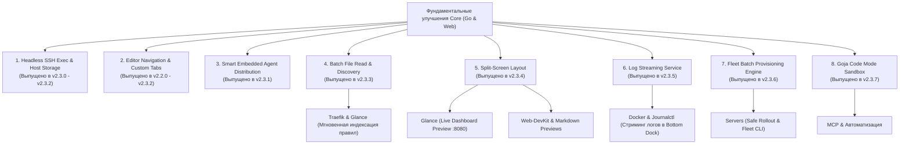

# Config Studio Roadmap & Master Architecture Plan 🗺️

План развития экосистемы **Config Studio** и официальных плагинов.

> **Главный регламент разработки:**
> 1. **Сперва ядро (Core First):** Сначала реализуются и тестируются фундаментальные механизмы ядра редактора, валидации и точек расширения.
> 2. **Предварительное обсуждение:** Перед реализацией **каждой отдельной функции** мы подробно обсуждаем ее UX/UI, структуру данных и сценарии использования. Только после явного утверждения пишется код.
> 3. **Изолированный репозиторий для каждого расширения (One Repo Per Plugin):** Каждый официальный плагин экосистемы Config Studio (`config-studio-servers`, `config-studio-traefik`, `config-studio-web-devkit` и др.) разрабатывается, версионируется и сопровождается в **отдельном самостоятельном GitHub-репозитории** со своим кодом, тестами и релизным циклом, а центральный репозиторий `config-studio-plugins` выступает реестром пакетов и точкой дистрибуции `.cspkg`.
> 4. **Инженерная дисциплина (/ub-mode):** Вся разработка и модификация кодовой базы строго следует циклу: *First Make it Work* (Laziness Protocol: одно решение в одном месте, TDD, Boundary Discipline, Type System Discipline, Idempotence, Subtract Before You Add), *Then Make it Right* (устранение первопричин, дробление функций, удаление мертвого кода), *Follow Practice* (Keep a Log, Worktree Cleanup, Commit often with why/what/proof).
> 5. **Регламент ведения Roadmap (Roadmap Clean-State Discipline):** Секции текущего спринта и планируемых плагинов («В РАБОТЕ» / «ПЛАНИРУЕМЫЕ ПЛАГИНЫ») должны содержать **строго невыполненные задачи и бэклог (`- [ ]`)**. Как только этап или функция полностью завершена, она **всегда переносится вниз под спойлер (`

...
`) в архив выполненных этапов (Released)**. Верхний план никогда не должен захламляться выполненными чекбоксами.
> 6. **Обязательный релиз через GitHub Workflow и максимальное использование возможностей GitHub:** Каждое расширение и релиз должны компилироваться и выпускаться строго через GitHub Actions Workflow (`.github/workflows/release.yml`) при пуше тега версии (`v*`) или `workflow_dispatch`. Workflow автоматически запускает unit-тесты, собирает бандлы, упаковывает `.cspkg`, генерирует SHA-256 чексуммы и публикует официальный GitHub Release с артефактами. Максимально задействовать функционал платформы GitHub (Actions, Releases, Issues, Discussions). Новые расширения создаются на базе официального шаблона `config-studio-plugin-template`.
> 7. **Инкрементальное версионирование по пунктам Roadmap (Sub-versioning per Item):** Начиная с релиза **v2.3.0**, за каждый выполненный функциональный пункт из `Core Evolution Roadmap` выпускается отдельная подверсия ядра (**v2.3.1**, **v2.3.2**, **v2.3.3** и т.д.) с немедленным тестированием, обновлением архива и сборкой бинарников.
> 8. **Синхронизация документации плагинов (`config-studio-plugin-docs`):** При любом значительном изменении функционала ядра (новые REST/WS эндпоинты, методы `window.ConfigStudio`, сервисы, изменение моделей) обязательно синхронно обновлять файл определений типов TypeScript (`types/config-studio.d.ts`), документацию и примеры в репозитории `config-studio-plugin-docs`.
> 9. **Актуализация витрины компонентов (`config-studio-plugins/ui.html`):** После добавления или модификации любого UI-модуля библиотеки `@config-studio/ui` обязательно обновлять интерактивную витрину компонентов `config-studio-plugins/ui.html`, поддерживая 100% покрытие всех имеющихся библиотек, состояний и размеров.

---

## 🎯 ТЕКУЩИЙ ЭТАП / В РАБОТЕ (Current Sprint: v2.4.0 — v3.0.0 Prep)

> **Стратегический приоритет:** Все промежуточные версии ядра до **v3.0.0** выделены под полировку, баг-фиксы стабильности, регрессионное тестирование и подготовку/тестирование нативного десктопного окружения **Wails**.

### 🚨 ГЛАВНАЯ ЗАДАЧА: Сквозной аудит всей кодовой базы субагентом `@code-auditor` (Gemini 4 Hydrogen)
- [ ] **Тотальный прогон всей кодовой базы через субагента `@code-auditor`**:
  - **Бэкенд Go (`internal/*`, `cmd/*`)**: аудит всех пакетов ядра (`agent`, `audit`, `config`, `cspkg`, `fleet`, `fs`, `guard`, `hosts`, `logs`, `plugin`, `sandbox`, `secrets`, `server`, `ssh`, `sysinfo`) на предмет утечек памяти/горутин, race conditions, конкурентности сокетов, граничных условий и уязвимостей безопасности.
  - **Фронтенд React/TypeScript (`web/src/*`)**: аудит компонентов Monaco Editor, BottomDockStrip, Workspaces, Fleet, модальных окон и сторов на чистоту архитектуры, утечки слушателей событий, стабильность рендеринга и соответствие Clean Code.
  - **Плагины экосистемы**: проверка интерфейсов взаимодействия официальных расширений (`config-studio-servers`, `config-studio-traefik`, `config-studio-web-devkit`).
  - **Устранение и TDD-фиксация**: последовательное устранение найденных замечаний с фиксацией тестами (Pinning Tests) по методологии `ub-mode`.
  - **Регламент квоты**: строгое соблюдение суточного лимита (20 RPD) — вызов экспертного аудитора пакетами/модулями строго после реализации и первичного тестирования.

### 🛠️ Стабилизация, баг-фиксы и Wails Testing (Спринт v2.4.0 - v2.9.x)
- [ ] Тестирование и адаптация Go-бэкенда под Wails v2/v3 desktop shell.
- [ ] Регрессионное тестирование нативных оконных событий, трея и локальных сокетов.
- [ ] Исправление замечаний и багов пользовательского интерфейса.

### 💡 Отложенные задачи и бэклог (Backlog)
- [ ] **Глобальный реестр горячих клавиш плагинов**: `window.ConfigStudio.registerShortcut(key, handler)` для вызова плагинных действий с клавиатуры (отложено до расширения каталога плагинов; текущее управление полностью закрывается верхним тулбаром и клавишей `F5`).
- [ ] **Массовая раскатка конфигов (Safe Rollout Engine)**: Двухэтапная раскатка Canary-first с Diff & Approve и автоматическим rollback (отложено до масштабирования флота).
- [ ] **Fleet CLI (Массовое исполнение сервисных команд)**: Параллельный запуск сервисных команд на группе узлов (отложено в бэклог).
- [ ] **Diff Engine (`POST /api/fs/diff`)**: Визуальное сравнение файлов перед раскаткой (отложено вместе с Safe Rollout).

---

## 🏗️ ДОРОЖНАЯ КАРТА УЛУЧШЕНИЙ ЯДРА (Core Evolution Roadmap)

Фундаментальные сервисы и точки расширения ядра, создаваемые по принципу *Core First* перед реализацией соответствующих плагинов:

### 1. Пакетное чтение файлов и кросс-файловый поиск (Batch File Read & Discovery)
*(Выпущено в v2.3.3)*
- [x] Пакетное чтение файлов каталога: `POST /api/fs/batch-read` и `POST /api/sftp/batch-read` с поддержкой glob-масок (`rules/mw-*.yml`) для быстрой индексации без множественных сетевых запросов.

### 2. Разделенный экран (Split-Screen Workspace Layout)
*(Выпущено в v2.3.4)*
- [x] Режим двухпанельного сплита (Editor слева, Webview / Iframe справа) с перетаскиваемым разделителем в `App.tsx`.
- [x] Плагинное API: `window.ConfigStudio.registerSplitWebview({ id, title, url, refreshOnSave?: boolean })`.

### 3. Структурированный потоковый логгер (Log Streaming Service)
*(Выпущено в v2.3.5)*
- [x] Потоковый канал логов на бэкенде (Server-Sent Events) без ANSI-мусора PTY (`GET /api/logs/stream`).
- [x] Компонент Log Viewer в `@config-studio/ui` с поиском, паузой автоскролла и цветовой дифференциацией уровней (CRIT/ERROR/WARN/INFO/DEBUG).
- [x] Мульти-сессионная панель в `BottomDockStrip` с лаунчером быстрых пресетов (Docker, Journalctl, Syslog, Dmesg).
- [x] Плагинное API `window.ConfigStudio.logs` (`openStream`, `closeStream`, `getSessions`, `clear`, `reconnect`).

### 4. Воркер-пул флота и массовое развертывание агентов (Fleet Batch Provisioning)
*(Выпущено в v2.3.6)*
- [x] Серверный воркер-пул `BatchInstallAgents(ctx, opts, sshMgr, secMgr, onProgress)` с параллелизмом до 10 потоков.
- [x] Эндпоинты `POST /api/servers/batch-install` и потоковый `GET /api/servers/batch-install/stream` с SSE-прогрессом.
- [x] Автоматическая генерация уникальных TOTP-секретов для каждого узла с сохранением в Core Vault (`agent:<srvID>`).
- [x] Пропуск узлов с уже активным агентом (`skipHealthy`), поддержка sudo, автоопределение systemd/OpenRC.
- [x] Модальный интерфейс `openBatchInstallModal` в плагине `config-studio-servers v1.5.0` с прогресс-баром и журналами по каждому серверу.

### 5. Эфемерная песочница Goja (Code Mode Sandbox)
*(Выпущено в v2.3.7)*
- [x] Встраивание `github.com/dop251/goja` в пакет `internal/sandbox` с нулевым потреблением heap в покое.
- [x] Безопасный фасад ядра `cs.*` (`cs.servers`, `cs.ssh`, `cs.fs`, `cs.vault`) с лимитом времени (10s) и глубины стека.
- [x] REST API `POST /api/sandbox/eval` с изоляцией контекста для плагина `config-studio-mcp`.

---

## 🖧 СВОДНЫЙ КАТАЛОГ И СТАТУС ПЛАГИНОВ ЭКОСИСТЕМЫ (Master Plugin Catalog)

Сводный реестр всех 20 плагинов экосистемы Config Studio, история их развития, текущий статус и сопоставление запланированного функционала с фактически выполненным:

| Плагин / Репозиторий | Категория | Статус | Запланированный функционал | Выполненный объем vs Бэклог |
|---|---|:---:|---|---|
| **`config-studio-servers`** | Инфраструктура & Флот | ⚡ **Частично реализован** (v1.5.2) | Инвентарь `servers.yaml`, Universal Fleet Switcher, SSH Auto-Onboarding агента, Zero-Secret Vault, Embedded Agent Distribution (.cspkg), Массовая параллельная установка агента (Fleet Batch Provisioning). *(Отложено: Safe Rollout Diff & Approve / Canary-first, Fleet CLI).* | **Выполнено (v1.5.2):** Инвентарь, переключатель, SSH онбординг одиночного узла, стриминг бинарников агента из .cspkg, Vault, кастомные Dropdown с привязкой SSH хостов ядра и ручным вводом, Массовая параллельная установка агентов (Batch Provisioning Engine) с SSE-прогрессом. **Отложено в бэклог:** Массовая раскатка конфигов (Safe Rollout Engine) и Fleet CLI. |
| **`config-studio-glance`** | Дашборды & Закладки | 📋 **Запланирован** | 1-Click Baremetal Binary Updater (`glanceapp/glance`), каталог Community Widgets, архитектура `$include`, Any-Document Bookmark Generator (`Alt+B`), 1-Click Traefik Sync, Live Split-Screen предпросмотр (:8080) с авторелоадом. | **Выполнено:** Ядро подготовило `batchRead` (v2.3.3) и Split Layout (v2.3.4). **Осталось:** Полная реализация плагина по утвержденной спецификации. |
| **`config-studio-docker`** | Контейнеризация | 📋 **Запланирован** | Визуальный конструктор Compose, библиотека Blueprints (Postgres, Redis, Traefik), Pre-Save удаленная проверка (`docker compose config`), тулбар (`Up -d`, `Down`, `Pull`), SSE-стриминг логов в нижний док, дашборд статусов контейнеров/портов. | **Выполнено:** Базовый синтаксический guard YAML и Log Streaming Service (v2.3.5) ядра. **Осталось:** Полная реализация плагина по утвержденной спецификации. |
| **`config-studio-nginx`** | Веб-серверы & Прокси | 📋 **Запланирован** | Конструктор блоков `server`/`location`/`proxy_pass`, архитектурные шаблоны (SPA, WebSocket, SSL), Pre-Save удаленный синтаксический чекер `nginx -t`, 1-Click менеджер `sites-available` ➔ `sites-enabled`, монитор истечения SSL-сертификатов. | **Выполнено:** Поддержка подсветки `.conf` в ядре и SSH Headless API. **Осталось:** Полная реализация плагина по утвержденной спецификации. |
| **`config-studio-systemd`** | Системные службы | 📋 **Запланирован** | Генератор Unit-файлов (.service, .timer, .mount) с изоляцией ресурсов, удаленная валидация `systemd-analyze verify`, контекстная автодетекция службы по открытому конфигу, кнопки тулбара (daemon-reload, restart, status), превью логов. | **Выполнено:** Поддержка синтаксиса INI/Conf и Headless SSH. **Осталось:** Полная реализация плагина по утвержденной спецификации. |
| **`config-studio-journal`** | Логи & Наблюдаемость | 📋 **Запланирован** | Потоковый просмотр `/var/log/*` и `journalctl -f -u <service>` в Bottom Dock без ANSI-мусора, фильтрация по severity (Emerg...Debug), PID, временным окнам, пауза автопрокрутки, полнотекстовый поиск. | **Выполнено:** Нижняя док-панель ядра (Bottom Dock Strip) и Log Streaming Service (v2.3.5). **Осталось:** Реализация самого плагина (спецификация готова). |
| **`config-studio-crontab`** | Планировщик задач | 📋 **Запланирован** | Визуальный редактор `/etc/crontab`, `/etc/cron.d/*` и пользовательских crontab, конструктор интервалов, человекочитаемый перевод расписания на русский язык, расчет 5 следующих запусков, тестовый запуск команды в песочнице. | **Выполнено:** Базовое ядро редактора и SSH-интеграция. **Осталось:** Полная реализация плагина по утвержденной спецификации. |
| **`config-studio-wireguard`** | VPN & Безопасность | 📋 **Запланирован** | Визуальный конфигуратор `wg0.conf` (сеть, интерфейс, routing NAT), табличный менеджер пиров с автовыделением IP, локальная генерация Curve25519 ключей и QR-кодов для смартфонов, монитор рукопожатий и байт трафика. | **Выполнено:** Хранение секретов в Core Vault и Split-Screen для QR. **Осталось:** Полная реализация плагина по утвержденной спецификации. |
| **`config-studio-singbox`** | Прокси & Маршрутизация | 📋 **Запланирован** | Редактор сложных деревьев JSON/JSON5, конструктор протоколов (VLESS Reality, Shadowsocks, Trojan, Hysteria 2), визуальная матрица правил маршрутизации по `geosite`/`geoip`, Pre-Save валидация `sing-box check`. | **Выполнено:** Поддержка JSON/JSONC в ядре и Monaco Editor. **Осталось:** Полная реализация плагина по утвержденной спецификации. |
| **`config-studio-makefile`** | DevOps & Сборка | 📋 **Запланирован** | Строгая ассоциация `fileMatches`, автопарсинг целей и docstrings, Action Toolbar сплит-кнопка запуска по `F5`, стриминг процесса компиляции в Bottom Dock с подсветкой ошибок и замером времени. | **Выполнено:** Концепция Action Toolbar и Bottom Dock в ядре. **Осталось:** Полная реализация плагина по утвержденной спецификации. |
| **`config-studio-mcp`** | AI & Автоматизация | 📋 **Запланирован** | Официальный сервер Model Context Protocol для Claude/Cursor/Antigravity, стандартные инструменты (`read_config`, `validate_structure`, `diff_config`, `deploy_remote`), Human-in-the-loop Approve Guard, Code Mode песочница Goja (`cs.*`). | **Выполнено:** Архитектурная спецификация Goja в Core Evolution. **Осталось:** Пакет ядра `internal/sandbox` и сам MCP-плагин. |
| **`config-studio-explorer-plus`** | Файловый менеджер | 📋 **Запланирован** | Продвинутый буфер обмена (`Ctrl+C`, `Ctrl+X`, `Ctrl+V`), дублирование файлов в 1 клик, создание быстрых снимков `.bak` перед правками, множественный выбор файлов (Multi-select), расширение контекстного меню. | **Выполнено:** Нативное контекстное меню SFTP и Time Machine в ядре. **Осталось:** Реализация плагинного расширения файлового дерева. |
| **`config-studio-traefik`** | Reverse Proxy | 🚀 **Выпущен** (v1.0.0, v1.1.0, v1.1.2) | Многофайловый провайдер `/etc/traefik/rules/` (`mw-*.yml` + `ser-*.yml`), автокомплит, Go to Definition с импульсной подсветкой, Матрица правил, Linter коллизий, Мастер сервисов, Каталог Blueprints (7 рецептов), Traefik Doctor, пакетный опрос `batchRead`. | **100% ВЫПОЛНЕНО И ВЫПУЩЕНО.** Репозиторий изолирован, пакет `traefik-1.1.2.cspkg` опубликован на GitHub Releases и в каталоге `registry.json`. |
| **`config-studio-web-devkit`** | Веб-разработка | ⚡ **Частично реализован** (v1.3.3) | Live Preview HTML/PHP, Chrome Browser Bar, ресайзер устройств, сервер :8085, AST Outline; Словари HTML5 (110+ тегов, атрибуты), словари PHP (функции, суперглобалы `$_GET`, `$_POST`, `$_SERVER`), Auto-Closing Tags (`<...></...>`, `;`), DOM-валидация парности тегов, библиотека веб-шаблонов Blueprints. | **Выполнено (v1.3.3):** Live Preview с Split Layout, Chrome Bar, сервер :8085, базовые сниппеты, AST Outline. **Осталось (v1.4.0):** Полные словари HTML5/PHP, автозакрытие тегов `<...></...>`, автодополнение `;`, DOM-валидация разметки, библиотека Blueprints. |
| **`config-studio-sysinfo`** | Телеметрия | 🚀 **Выпущен** (v1.2.0) | Сбор метрик CPU/RAM/диска/сети, REST API `/api/sysinfo`, стриминг системной информации, анимированные графики в карточках серверов. | **100% ВЫПОЛНЕНО И ВЫПУЩЕНО.** Вынесен в автономный модуль телеметрии ядра и UI-индикаторы. |
| **`config-studio-terminal`** | Веб-терминал | 🚀 **Выпущен** (v1.1.0) | Полноценный эмулятор xterm.js в нижнем доке, мультисессии, бинарный WebSocket PTY мост, SSH авто-сессии, интеграция с инвентарем. | **100% ВЫПОЛНЕНО И ВЫПУЩЕНО.** Интегрирован непосредственно в нижний док ядра `BottomDockStrip`. |
| **`config-studio-vault`** | Безопасность | 🛡️ **Поглощен ядром** (v1.9.0) | Хранение паролей, SSH-ключей, токенов и сертификатов с AES-256-GCM шифрованием и мастер-паролем. | **Поглощен ядром.** Реализован как фундаментальный сервис Core Secrets Store & Vault API. |
| **`config-studio-backup`** | Бэкапы & Версионирование | 🛡️ **Поглощен ядром** (v2.0.0) | Создание снимков конфигураций, версионирование, сравнение изменений и откат в 1 клик. | **Поглощен ядром.** Реализован как визуальная Time Machine с DiffEditor и ревизиями в редакторе Monaco. |
| **`config-studio-ssh`** | Удаленный доступ | 🛡️ **Поглощен ядром & серверами** | Подключение по SSH ключам и паролям, SFTP выгрузка файлов, выполнение команд на удаленных узлах. | **Поглощен ядром & плагином `servers`.** Реализованы Headless Remote SSH Exec API, SFTP модалка и центральный Host Storage. |
| **`config-studio-remote-agent`** | Удаленный агент | 🛡️ **Поглощен плагином `servers`** | Легковесный бинарный Go-демон для выполнения операций на удаленных серверах, TOTP авторизация. | **Поглощен плагином `servers`.** Превращен во встроенный агент (Embedded Agent v2.3.0) с прямой доставкой через `.cspkg`. |

---

## 📜 ПОЛНЫЕ СПЕЦИФИКАЦИИ ПЛАНИРУЕМЫХ И ЧАСТИЧНО РЕАЛИЗОВАННЫХ ПЛАГИНОВ

Ниже зафиксированы детальные архитектурные и функциональные спецификации для всех 13 плагинов, находящихся в стадии разработки или планирования:

---

### 1. `config-studio-servers` («Серверы и Флот» — v1.5.2)
*Единый центр управления физическими серверами, VPS и кластерами с возможностью массового развертывания агентов.*

- **Текущее состояние:** Выпущены версии v1.0.0 — v1.5.2 (YAML инвентарь `servers.yaml`, Universal Fleet Switcher с кнопками `[ ⚡ Агент ]`, `[ 📁 SFTP ]`, `[ >_ Шелл ]`, 1-Click SSH Auto-Onboarding для одиночного узла, Embedded Agent Distribution с доставкой бинарников из `.cspkg`, интеграция с Core Vault, кастомные Dropdown, Массовая установка агентов с SSE-дашбордом).
- **Файловые ассоциации (`fileMatches`):** `["servers.yaml", "servers.yml", "fleet.yaml"]`.
- **Требуемые разрешения ядра (`permissions`):** `ssh.exec`, `secrets.read`, `fs.batchRead`, `ui.toolbar`, `ui.bottomDock`, `ui.modal`.

#### 💡 Отложенные задачи в бэклог (Deferred Backlog):
- [ ] **Fleet CLI (Массовое исполнение сервисных команд)** *(Отложено в бэклог)*:
  - [ ] Выполнение сервисных команд обслуживания (`systemctl restart <unit>`, `docker compose pull && docker compose up -d`, `apt update`) одновременно на выбранной группе серверов.
  - [ ] Вывод результатов в нижний док с группировкой по хостам (вкладки хостов, бейджи статуса OK/ERR, цветовая индикация времени отклика).
- [ ] **Массовая раскатка конфигов (Safe Rollout Engine)**:
  - [ ] Сводный предпросмотр Diff & Approve перед применением файла на выбранную группу узлов (эндпоинт `POST /api/fs/diff`).
  - [ ] Canary-first раскатка (1 тестовый узел с тегом `CANARY` -> валидатор `docker compose config` / `nginx -t` / health check -> раскатка на остальные).
  - [ ] Автоматический план отката (1-Click Rollback) при сбое канарейки.

---

### 2. `config-studio-glance` (Glance Dashboard & Smart Bookmarks Studio)
*Интеллектуальная среда настройки персонального дашборда Glance, экосистемы комьюнити-виджетов и сквозных закладок.*

- **Файловые ассоциации (`fileMatches`):** `["glance.yml", "glance.yaml", "widgets/*.yml", "widgets/*.yaml"]`.
- **Требуемые разрешения ядра (`permissions`):** `ui.splitWebview`, `ui.toolbar`, `ui.contextMenu`, `fs.batchRead`, `ssh.exec`, `secrets.read`.

#### Полная функциональная спецификация:
- [ ] **1-Click Baremetal Binary Updater**:
  - [ ] Автоматическая проверка свежих релизов в официальном репозитории `glanceapp/glance` через GitHub Releases API.
  - [ ] Скачивание скомпилированного Go-бинарника под целевую архитектуру сервера (`linux/amd64` или `linux/arm64`).
  - [ ] Атомарная замена исполняемого файла в `/opt/glance/glance` и быстрый перезапуск службы `systemctl restart glance` за <2 секунд (без Node.js, без компиляции и без риска Out-Of-Memory на дешевых VPS с 512MB RAM).
- [ ] **Каталог Community Widgets (`glanceapp/community-widgets`)**:
  - [ ] Встроенная в плагин интерактивная витрина официальных и комьюнити виджетов (Proxmox, Immich, Nextcloud, AdGuard Home, Uptime Kuma, Jellyfin, Pi-hole, Transmission, Portainer) с поиском и превью внешнего вида.
  - [ ] Установка в 1 клик: автоматическая выгрузка YAML-файла виджета в локальную поддиректорию воркспейса `widgets/<name>.yml`.
  - [ ] Автоматическое внедрение директивы `- $include: widgets/<name>.yml` в целевую секцию страниц файла `glance.yml`.
  - [ ] Безопасный мастер ввода конфиденциальных данных: обнаружение токенов и паролей виджета с предложением сохранить их в Core Vault и подставить безопасные переменные `${VAULT_KEY}`.
- [ ] **Поддержка многофайловой архитектуры директивы `$include`**:
  - [ ] Быстрый переход к определению (Go to Definition): клик по ссылке `- $include: widgets/file.yml` или нажатие `F12` открывает включаемый файл виджета в редакторе с импульсной подсветкой.
  - [ ] Линтер целостности связей: однопроходная проверка физического существования файлов инклюдов через `fs.batchRead` и предупреждение о битых ссылках с помощью маркеров Monaco.
  - [ ] Рефакторинг в 1 клик: действие «Вынести виджет в отдельный файл $include» с автоматическим переносом YAML-блока в `widgets/` и заменой на директиву включения.
- [ ] **Универсальный генератор закладок в любом документе (Any-Document Bookmark Generator)**:
  - [ ] Автодетекция веб-сервисов: при редактировании файлов Docker Compose, Nginx `.conf`, Traefik `ser-*.yml`, Kubernetes или Markdown плагин парсит директивы портов (`ports: 8080:80`), внешние хосты `Host(example.com)` и веб-ссылки `http://...`.
  - [ ] Пункт контекстного меню редактора и кнопка тулбара: «🔖 Добавить закладку в Glance».
  - [ ] Горячая клавиша `Alt+B`: мгновенный вызов модального окна добавления закладки с автозаполнением URL, заголовка и выбором группы в `glance.yml`.
  - [ ] Пакетный импортер (Batch Bookmark Importer): генерация группы закладок в Glance из всех веб-сервисов открытого проекта в 1 клик.
- [ ] **1-Click синхронизация с Traefik**:
  - [ ] Межплагинная интеграция: чтение файлов каталога `/etc/traefik/rules/ser-*.yml` через `fs.batchRead`.
  - [ ] Автоматическая генерация или обновление карточек сервисов с иконками и доменами в `glance.yml`.
- [ ] **Живой Split-Screen предпросмотр дашборда**:
  - [ ] Регистрация правой панели через Core Split API (`window.ConfigStudio.registerSplitWebview`).
  - [ ] Отображение живого веб-интерфейса Glance (`http://<host>:8080`) бок о бок с редактором YAML.
  - [ ] Автоматическая перезагрузка фрейма (`refreshOnSave: true`) при каждом сохранении `Ctrl+S` в `glance.yml` или файлах `widgets/*.yml`.
  - [ ] Иерархический AST Outline документа `glance.yml` (страницы, колонки, блоки виджетов, инклюды) с навигацией по клику.

---

### 3. `config-studio-docker` (Docker & Compose Studio)
*Профессиональная среда разработки, валидации и управления контейнеризированными стеками Docker Compose.*

- **Файловые ассоциации (`fileMatches`):** `["docker-compose.yml", "docker-compose.yaml", "compose.yml", "compose.yaml", "Dockerfile", "Dockerfile.*"]`.
- **Требуемые разрешения ядра (`permissions`):** `ui.toolbar`, `ui.contextMenu`, `ui.bottomDock`, `ssh.exec`, `logs.stream`, `fs.batchRead`.

#### Полная функциональная спецификация:
- [ ] **Интерактивный конструктор Compose-файлов**:
  - [ ] Визуальные формы настройки сервисов (`services`), постоянных хранилищ (`volumes`), изолированных сетей (`networks`) и переменных окружения (`environment`, `env_file`).
  - [ ] Двунаправленная синхронизация (Bi-directional Binding): любые изменения в визуальной форме мгновенно обновляют YAML в Monaco Editor и наоборот.
  - [ ] Интеллектуальный автокомплит популярных образов Docker Hub с версиями (tags) и синтаксиса монтирования томов.
- [ ] **Каталог шаблонов лучших практик (Blueprints)**:
  - [ ] Готовые проверенные конфигурации:
    - Стек СУБД: PostgreSQL + PgAdmin / Redis + Redis Commander.
    - Веб-стек: Traefik v3 + Whoami + SSL ACME.
    - Стек мониторинга: Prometheus + Grafana + Node Exporter.
    - Стек бэкапов: Restic / BorgBackup с расписанием.
- [ ] **Pre-Save Remote Validation (`docker compose config`)**:
  - [ ] При нажатии `Ctrl+S` или попытке отправки файла по SFTP на целевом хосте неинтерактивно вызывается `docker compose config` через Headless SSH API.
  - [ ] В случае синтаксических ошибок, циклических зависимостей `depends_on`, невалидных портов или незаданных переменных окружения всплывает Pre-Save Guard с блокировкой записи и строчной подсветкой ошибок.
- [ ] **Action Toolbar (1-Click панель управления стеком)**:
  - [ ] Кнопки быстрых действий в шапке редактора: `[ ▶ Compose Up -d ]`, `[ ⏹ Down ]`, `[ 🔄 Restart ]`, `[ ⬇ Pull ]`.
  - [ ] Индикатор текущего статуса стека: Running / Stopped / Degraded.
- [ ] **Стриминг логов в реальном времени (Bottom Dock)**:
  - [ ] Потоковый вывод `docker compose logs -f --tail=200` через потоковый сервис ядра (Log Streaming Service v2.3.5) без искажений PTY.
  - [ ] Фильтрация потока по конкретному контейнеру стека, пауза автопрокрутки, полнотекстовый поиск.
- [ ] **Интерактивный Dashboard контейнеров и портов**:
  - [ ] Вкладка в нижней панели: список активных контейнеров, статус healthcheck, потребление памяти/CPU и кликабельные сетевые порты (`http://localhost:XXXX`).

---

### 4. `config-studio-nginx` (Nginx & Web Server Studio)
*Инструмент конструирования, удаленной проверки синтаксиса и управления виртуальными хостами веб-сервера Nginx.*

- **Файловые ассоциации (`fileMatches`):** `["nginx.conf", "*.conf", "/etc/nginx/**"]`.
- **Требуемые разрешения ядра (`permissions`):** `ui.toolbar`, `ui.contextMenu`, `ssh.exec`, `fs.batchRead`, `secrets.read`.

#### Полная функциональная спецификация:
- [ ] **Визуальный конструктор блоков конфигурации**:
  - [ ] Генератор секций `http`, `server`, `location`, `upstream`.
  - [ ] Интеллектуальный справочник директив с валидацией контекста использования (запрет директив уровня `http` внутри `location`).
  - [ ] Автокомплит заголовков безопасности: HSTS, X-Frame-Options, CSP, Referrer-Policy, CORS.
- [ ] **Каталог архитектурных шаблонов (Blueprints)**:
  - [ ] Реверс-прокси для современных веб-приложений (Next.js, Node.js, Go, Python) с поддержкой WebSocket и апстримов.
  - [ ] Оптимальный хостинг Single Page Applications (SPA) с корректным роутингом `try_files $uri /index.html`.
  - [ ] Конфигурация статического кэширования медиа-файлов со сжатием Brotli/Gzip.
  - [ ] SSL/TLS профили безопасности от Mozilla (Modern / Intermediate).
- [ ] **Pre-Save Syntax Check (`nginx -t`)**:
  - [ ] Автоматическое выполнение команды `sudo nginx -t` на удаленном сервере перед сохранением или выгрузкой конфига.
  - [ ] При обнаружении ошибок парсинга (пропущенная точка с запятой, незакрытая скобка, конфликт портов) выдается предупреждение с точным указанием номера строки и имени файла.
- [ ] **1-Click Управление сайтами (`sites-available` ➔ `sites-enabled`)**:
  - [ ] Обзор всех доступных виртуальных хостов на сервере.
  - [ ] Включение и отключение сайтов в 1 клик через создание/удаление символических ссылок в `/etc/nginx/sites-enabled/`.
  - [ ] Кнопка безопасного применения изменений `[ 🔄 Nginx Reload ]` (выполняет цепочку `nginx -t && systemctl reload nginx`).
- [ ] **Монитор срока годности SSL/TLS сертификатов**:
  - [ ] Автоматическое извлечение путей `ssl_certificate` из активного конфига.
  - [ ] Запрос срока окончания сертификата через SSH (`openssl x509 -enddate -noout`).
  - [ ] Предупреждающие цветовые бейджи за 30, 14 и 3 дня до истечения срока действия с рекомендацией обновления Certbot.

---

### 5. `config-studio-systemd` (Systemd Service & Timer Studio)
*Генератор надежных Unit-файлов, аудит изолированности сервисов и оперативное управление демонами Linux.*

- **Файловые ассоциации (`fileMatches`):** `["*.service", "*.timer", "*.mount", "*.socket", "/etc/systemd/system/**", "/lib/systemd/system/**"]`.
- **Требуемые разрешения ядра (`permissions`):** `ui.toolbar`, `ui.contextMenu`, `ui.bottomDock`, `ssh.exec`, `logs.stream`.

#### Полная функциональная спецификация:
- [ ] **Конструктор Unit-файлов с лучшими практиками надежности**:
  - [ ] Визуальные формы создания секций `[Unit]`, `[Service]`, `[Install]`, `[Timer]`.
  - [ ] Готовые пресеты отказоустойчивости: автоматический перезапуск (`Restart=always`, `RestartSec=5s`), ограничения потребления ресурсов (`MemoryMax=512M`, `CPUQuota=50%`).
  - [ ] Пресеты песочницы безопасности (Hardening): `ProtectSystem=strict`, `ProtectHome=yes`, `NoNewPrivileges=yes`, `PrivateTmp=yes`.
- [ ] **Удаленная валидация синтаксиса (`systemd-analyze verify`)**:
  - [ ] Проверка корректности структуры юнита на целевом хосте перед сохранением файла.
- [ ] **Контекстная автодетекция службы**:
  - [ ] Определение ассоциированного сервиса из любого открытого в редакторе конфигурационного файла:
    - `nginx.conf` ➔ `nginx.service`
    - `postgresql.conf` ➔ `postgresql.service`
    - `redis.conf` ➔ `redis-server.service`
- [ ] **Action Toolbar & Жизненный цикл службы**:
  - [ ] Кнопки в тулбаре редактора: `[ ⚡ daemon-reload ]`, `[ ▶ Start ]`, `[ ⏹ Stop ]`, `[ 🔄 Restart ]`, `[ 📊 Status ]`.
  - [ ] Статусный бейдж в строке состояния (`active (running)`, `inactive (dead)`, `failed`).
- [ ] **Превью логов службы в Bottom Dock**:
  - [ ] Однокликовое открытие журнала службы `journalctl -u <unit> -n 50 --no-pager` в нижней док-панели.

---

### 6. `config-studio-journal` (Journalctl & Syslog Streamer)
*Высокопроизводительный просмотрщик и стример системных логов в реальном времени.*

- **Файловые ассоциации (`fileMatches`):** `["*.log", "/var/log/**"]` (а также вызов из тулбара других плагинов).
- **Требуемые разрешения ядра (`permissions`):** `ui.bottomDock`, `logs.stream`, `ssh.exec`.

#### Полная функциональная спецификация:
- [ ] **Потоковый стриминг системных логов в реальном времени**:
  - [ ] Подключение к `journalctl -f` и файлам журнала `/var/log/{syslog,messages,auth.log}` через Log Streaming Service ядра v2.3.5 (SSE / WebSocket).
  - [ ] Чистый рендеринг без управляющих символов терминала (PTY artifacts).
- [ ] **Интеллектуальная фильтрация**:
  - [ ] Селектор уровня критичности (Severity levels): Emergency, Alert, Critical, Error, Warning, Notice, Info, Debug.
  - [ ] Фильтрация по имени юнита (`-u <service>`), PID процесса и временным интервалам (`--since "1 hour ago"`).
- [ ] **Эргономика анализа логов**:
  - [ ] Пауза потока при наведении или клике (Freeze Stream) для фиксации места сбоя.
  - [ ] Мгновенный полнотекстовый поиск по ключевым словам с подсветкой результатов.
  - [ ] Цветовая маркировка: ярко-красный фон для ошибок и сбоев ядра, желтый для предупреждений, нейтральный для информационных строк.

---

### 7. `config-studio-crontab` (Crontab & Timers Visualizer)
*Визуальный планировщик периодических задач с расшифровкой выражений на естественный язык.*

- **Файловые ассоциации (`fileMatches`):** `["crontab", "cron.*", "/etc/cron*/**", "/etc/crontab"]`.
- **Требуемые разрешения ядра (`permissions`):** `ui.toolbar`, `ui.panels`, `ssh.exec`.

#### Полная функциональная спецификация:
- [ ] **Визуальный редактор расписаний Cron**:
  - [ ] Управление пользовательскими расписаниями (`crontab -l`, `crontab -e`) и системными файлами (`/etc/cron.d/*`, `/etc/crontab`).
  - [ ] Конструктор интервалов: выбор периодичности кликом мыши (минуты, часы, дни месяца, месяцы, дни недели) без необходимости ручного ввода пяти звездочек.
- [ ] **Человекочитаемый перевод расписания (Cron Humanizer)**:
  - [ ] Интеллектуальный транслятор синтаксиса на естественный русский язык (например, `*/15 0-4 * * 1-5` ➔ *«Каждые 15 минут с 00:00 до 04:59, с понедельника по пятницу»*).
  - [ ] Визуальный календарь: расчет и вывод точного расписания следующих 5 запусков задачи.
- [ ] **Тестовый запуск и аудит (Test Run & Lint)**:
  - [ ] Кнопка `[ ▶ Тестовый запуск ]` для проверки выполнения команды на удаленном сервере с фиксацией кода возврата, времени работы и вывода stdout/stderr.
  - [ ] Linter предупреждений: подсветка отсутствия абсолютных путей к утилитам (`curl` вместо `/usr/bin/curl`), предупреждение о пропущенном символе новой строки в конце crontab.

---

### 8. `config-studio-wireguard` (WireGuard VPN & Tunnel Studio)
*Визуальный конфигуратор защищенных туннелей WireGuard, генератор ключей и QR-кодов для клиентов.*

- **Файловые ассоциации (`fileMatches`):** `["wg0.conf", "wg*.conf", "/etc/wireguard/**"]`.
- **Требуемые разрешения ядра (`permissions`):** `ui.toolbar`, `ui.splitWebview`, `ssh.exec`, `secrets.read`.

#### Полная функциональная спецификация:
- [ ] **Визуальный конфигуратор интерфейса и клиентов**:
  - [ ] Настройка секции сервера `[Interface]`: приватный ключ, IP-подсеть (`10.8.0.1/24`), порт прослушивания (`51820`), правила iptables для NAT (`PostUp` / `PostDown`).
  - [ ] Табличный менеджер клиентов `[Peer]`: имя клиента, автоматическое назначение свободного IP без коллизий, список разрешенных IP (`AllowedIPs`), Endpoint и Keepalive.
- [ ] **Генератор ключей и QR-кодов в 1 клик**:
  - [ ] Локальная криптографическая генерация ключевых пар Curve25519 (Private / Public Key) и PresharedKey.
  - [ ] Мгновенный вывод QR-кода готового конфига в правой сплит-панели редактора (Core Split API) для сканирования мобильным приложением WireGuard со смартфона.
  - [ ] Скачивание готового файла `client.conf` в 1 клик.
- [ ] **Мониторинг рукопожатий и трафика (Handshake Monitor)**:
  - [ ] Чтение телеметрии `wg show` через Headless SSH API.
  - [ ] Отображение актуального статуса каждого пира: время последнего рукопожатия (Last Handshake), объем переданных и принятых байт, статус онлайн/офлайн.

---

### 9. `config-studio-singbox` (Sing-box Rule Routing Studio)
*Интеллектуальный конструктор узлов и матричного роутинга для универсального прокси-клиента Sing-box.*

- **Файловые ассоциации (`fileMatches`):** `["sing-box.json", "config.json", "*.json", "*.json5"]`.
- **Требуемые разрешения ядра (`permissions`):** `ui.toolbar`, `ui.panels`, `ssh.exec`, `fs.batchRead`.

#### Полная функциональная спецификация:
- [ ] **Интеллектуальный редактор структуры JSON / JSON5**:
  - [ ] Парсинг и валидация схемы Sing-box с поддержкой комментариев (JSON5).
  - [ ] Иерархическое дерево навигации по ключевым секциям: `inbounds`, `outbounds`, `route`, `dns`, `experimental`.
- [ ] **Конструктор протоколов и входящих/исходящих узлов**:
  - [ ] Готовые формы добавления узлов: VLESS (Reality, XTLS), Shadowsocks (2022), Trojan, Hysteria 2, TUIC, WireGuard.
  - [ ] Проверка обязательных параметров: UUID, публичный ключ Reality, SNI, порты и алгоритмы шифрования.
- [ ] **Визуальный матричный роутинг (Route Rules Configurator)**:
  - [ ] Интерактивный конструктор правил: маршрутизация по категориям `geosite` (`geosite:category-ads-all`, `geosite:google`), базам `geoip` (`geoip:ru`, `geoip:private`), портам и доменным суффиксам.
  - [ ] Наглядная матрица привязки правил к исходящим узлам (`outbounds`: Direct, Block, Proxy, Warp).
- [ ] **Pre-Save Remote Validation (`sing-box check`)**:
  - [ ] Выполнение проверки синтаксиса и схемы на сервере перед сохранением файла.

---

### 10. `config-studio-makefile` (Makefile Runner & Build Streamer)
*Автоматизация выполнения сборочных сценариев и DevOps-команд со строгой файловой привязкой.*

- **Файловые ассоциации (`fileMatches`):** `["Makefile", "makefile", "GNUmakefile", "*.mk"]`.
- **Требуемые разрешения ядра (`permissions`):** `ui.toolbar`, `ui.panels`, `ui.bottomDock`, `terminal.exec`, `logs.stream`.

#### Полная функциональная спецификация:
- [ ] **Строгая файловая ассоциация (`fileMatches`)**:
  - [ ] Кнопки и панели плагина активируются строго при открытии файлов Makefile, гарантируя нулевое визуальное захламление интерфейса при редактировании обычных конфигов.
- [ ] **Автопарсинг целей и документации (Targets & Docstrings)**:
  - [ ] Автоматическое извлечение всех объявленных целей (`build`, `test`, `run`, `deploy`, `lint`, `clean`).
  - [ ] Считывание однострочных комментариев-описаний к целям (например, `## Build production binary`).
- [ ] **Action Toolbar со сплит-кнопкой запуска**:
  - [ ] Кнопка в тулбаре редактора `[ ▶ Run: default ▾ ]` с выпадающим списком всех найденных целей.
  - [ ] Нажатие клавиши `F5` запускает выполнение дефолтной или последней выбранной цели.
  - [ ] Отображение дерева целей в панели структуры (Outline) с возможностью запуска по двойному клику.
- [ ] **Потоковый стриминг сборки в Bottom Dock**:
  - [ ] Вывод stdout/stderr компилятора в реальном времени с подсветкой синтаксиса ошибок, фиксацией затраченного времени и итогового кода возврата.

---

### 11. `config-studio-mcp` (Model Context Protocol & Code Mode Engine)
*Превращение Config Studio в официальный MCP-сервер и локальную песочницу для ИИ-ассистентов.*

- **Файловые ассоциации (`fileMatches`):** `["*"]` (глобальный инфраструктурный плагин).
- **Требуемые разрешения ядра (`permissions`):** `secrets.read`, `fs.batchRead`, `ssh.exec`.

#### Полная функциональная спецификация:
- [ ] **Стандартный MCP-сервер для внешних ИИ (Claude Desktop, Cursor, Antigravity, Ollama)**:
  - [ ] Экспорт стандартных инструментов MCP:
    - `read_config(path)`: чтение файла с извлечением структуры AST.
    - `validate_structure(content, format)`: валидация синтаксиса встроенным ядром Config Studio (YAML, JSON, TOML, ENV).
    - `diff_config(path, new_content)`: генерация безопасного side-by-side diff.
    - `deploy_remote(server_id, path)`: доставка файла на целевой узел через флотовый механизм.
  - [ ] Экспорт ресурсов MCP:
    - `config-studio://projects/tree`: актуальное дерево файлов открытого воркспейса.
    - `config-studio://servers/status`: список подключенных серверов и их доступность.
- [ ] **Изоляция и Human-in-the-loop Approve Guard**:
  - [ ] По умолчанию все инструменты MCP функционируют строго в режиме Read-Only.
  - [ ] Любое деструктивное действие (запись файла, выполнение shell-команды, раскатка конфига) блокируется до явного подтверждения пользователем в модальном диалоге Config Studio.
- [ ] **Архитектура Code Mode (Эфемерная песочница Goja в ядре)**:
  - [ ] Интеграция чистого Go-интерпретатора JS `github.com/dop251/goja` в пакете ядра `internal/sandbox`.
  - [ ] Zero-Overhead в покое: 0 байт heap памяти, пока нет вызовов; инициализация и очистка за <1 мс через GC Go.
  - [ ] Мета-инструмент `execute_script(code)`: локальная пакетная фильтрация данных и оркестрация в 1 сетевой шаг вместо десятков последовательных HTTP-вызовов MCP.
  - [ ] Безопасный фасад ядра `cs.*`: строго изолированный доступ к инвентарю серверов (`cs.servers`), SSH-командам (`cs.ssh`), файловой системе (`cs.fs`) и хранилищу секретов (`cs.vault`) с таймаутом (10 сек) и лимитом глубины стека.
  - [ ] Поддержка пользовательских макросов автоматизации в интерфейсе (Script Book).

---

### 12. `config-studio-explorer-plus` (Dev & File Tools)
*Расширенные операции над файлами, групповые действия и буфер обмена в проводнике редактора.*

- **Файловые ассоциации (`fileMatches`):** `["*"]` (проводник файлов).
- **Требуемые разрешения ядра (`permissions`):** `ui.contextMenu`, `fs.operations`.

#### Полная функциональная спецификация:
- [ ] **Полноценный буфер обмена в проводнике**:
  - [ ] Поддержка горячих клавиш `Ctrl+C` (копировать), `Ctrl+X` (вырезать), `Ctrl+V` (вставить) при фокусе на дереве файлов.
  - [ ] Вставка скопированного файла в выбранную папку с автоматическим разрешением коллизий (`filename_copy.yaml`).
- [ ] **Дублирование в 1 клик (Duplicate)**:
  - [ ] Мгновенное клонирование файла с генерацией суффикса копии для быстрого тестирования альтернативных конфигов.
- [ ] **Быстрые бэкапы (.bak / Quick Backup)**:
  - [ ] Создание резервной копии перед опасными правками с временной меткой (`nginx.conf.bak` или `app.2026-11-16.bak`).
- [ ] **Групповые операции (Multi-select)**:
  - [ ] Выделение группы файлов через `Shift` / `Ctrl` для массового копирования, перемещения или удаления.
- [ ] **Расширение контекстного меню проводника**:
  - [ ] Интеграция со слотом Context Menu Provider: вызов внешних плагинных действий (например, «Compose Up» для `docker-compose.yml`, «Nginx Test» для `nginx.conf`).

---

### 13. `config-studio-web-devkit` (Web DevKit & Live Environment — Этап v1.4.0)
*Полноценная среда веб-верстки и PHP-разработки: словари тегов, автозакрытие парных тегов, DOM-валидация и веб-шаблоны.*

- **Текущее состояние:** Выпущены версии v1.0.0 — v1.3.3 (Live Preview в iframe со Split API v2.3.4, имитация панели Chrome Browser, выбор устройств Desktop 1280px / Tablet 768px / Mobile 375px, запуск встроенного сервера `php -S` / `python -m http.server` на порту 8085, базовый AST Outline для HTML и PHP, стартовые кнопки index.html / index.php в Launchpad, 7 простейших сниппетов).
- **Файловые ассоциации (`fileMatches`):** `[".html", ".htm", ".xhtml", ".php", ".phtml", ".svg", ".vue", ".css", ".js"]`.
- **Требуемые разрешения ядра (`permissions`):** `ui.splitWebview`, `ui.panels`, `ui.toolbar`, `ui.contextMenu`, `terminal.exec`, `network.bind`.

#### Полная функциональная спецификация Этапа v1.4.0:
- [ ] **Словари тегов и атрибутов HTML5 (HTML5 Dictionaries & Completions)**:
  - [ ] Полный словарь всех стандартных 110+ тегов HTML5 с описанием и сниппетами: структурные (`header`, `nav`, `main`, `footer`, `section`, `article`, `aside`), медиа (`video`, `audio`, `picture`, `source`, `canvas`, `figure`, `figcaption`), формы (`form`, `input`, `textarea`, `select`, `option`, `button`, `label`, `fieldset`, `legend`), интерактивные (`details`, `summary`, `dialog`, `template`, `slot`), таблицы (`table`, `thead`, `tbody`, `tfoot`, `tr`, `th`, `td`).
  - [ ] Контекстный словарь HTML-атрибутов: общие (`id`, `class`, `style`, `title`, `hidden`, `tabindex`), атрибуты форм (`action`, `method`, `type`, `name`, `value`, `placeholder`, `required`, `disabled`, `readonly`, `pattern`), ссылки и медиа (`href`, `target`, `rel`, `src`, `alt`, `loading="lazy"`), доступность (`aria-*`, `role`).
- [ ] **Словари функций и суперглобалов PHP (PHP Dictionaries & IntelliSense)**:
  - [ ] Справочник и автодополнение всех суперглобальных массивов PHP с документацией: `$_GET`, `$_POST`, `$_SERVER`, `$_SESSION`, `$_COOKIE`, `$_FILES`, `$_ENV`, `$_REQUEST`, `$GLOBALS`.
  - [ ] Словарь ключевых встроенных функций PHP по категориям:
    - Строковые: `strlen`, `str_contains`, `str_starts_with`, `str_ends_with`, `substr`, `trim`, `explode`, `implode`, `str_replace`, `sprintf`.
    - Массивы: `count`, `in_array`, `array_key_exists`, `array_map`, `array_filter`, `array_merge`, `array_push`, `array_column`.
    - JSON & HTTP: `json_encode`, `json_decode`, `header`, `http_response_code`, `setcookie`.
    - Дата & Время: `date`, `time`, `strtotime`, `DateTimeImmutable`.
    - Базы данных & PDO: `new PDO(...)`, `prepare`, `execute`, `fetch`, `fetchAll`.
- [ ] **Автоматическое закрытие тегов и пунктуации (Auto-Closing Tags & Auto-Close Pairs)**:
  - [ ] Реализация Auto Closing Tags для HTML/PHP в Monaco Editor: при вводе завершающего символа `>` открывающего не-void тега (например, `
`, `<section>`, ``) автоматически подставляется парный закрывающий тег `
` с установкой курсора между тегами.
  - [ ] Умное закрытие: игнорирование void-элементов HTML5 (` `, `
`, ``, `<input>`, `<meta>`, `<link>`), в которых закрывающий тег недопустим.
  - [ ] Автодополнение парных символов и кавычек: автозакрытие `<?php ... ?>`, кавычек в атрибутах `class=""` и автоподстановка завершающей точки с запятой `;` при переходе на новую строку в PHP.
- [ ] **DOM-валидация структуры разметки (HTML DOM Structure Linter)**:
  - [ ] Интеллектуальный анализатор парности тегов на клиенте без внешних тяжелых зависимостей.
  - [ ] Обнаружение незакрытых блочных тегов (например, открыт `
`, но файл закончился без `
`).
  - [ ] Обнаружение некорректного пересечения тегов (Invalid Tag Nesting: `<b><i>text</b></i>`).
  - [ ] Вывод диагностических маркеров ошибок в Monaco Editor (подчеркивание проблемных мест волнистой линией с подсказкой и номером строки).
- [ ] **Каталог веб-шаблонов (Web Blueprints Library)**:
  - [ ] Расширение Launchpad и меню New File готовыми рецептами:
    - Landing Page: чистый современный лендинг на Tailwind CDN.
    - Auth Screen: форма входа / регистрации с валидацией.
    - Dashboard Layout: боковое меню, хедер и адаптивная сетка карточек.
    - PHP REST API Endpoint: контроллер обработки JSON-запросов с CORS, заголовками и ответом `200 OK`.

---

## 🗄️ АРХИВ ВЫПОЛНЕННЫХ ЭТАПОВ (Released)

<b>⚡ Детали релиза v2.3.7: Goja Code Mode Sandbox & Secure JS Facade (ПОЛНОСТЬЮ РЕАЛИЗОВАНО И ВЫПУЩЕНО В РЕЛИЗ)</b>

- [x] **Go Core Backend (`internal/sandbox` & `internal/server`)**:
  - Встроен сверхбыстрый ECMAScript 5.1+ движок `github.com/dop251/goja` с концепцией **эфемерости** (нулевое потребление heap в покое, создание под каждый вызов и мгновенный сборщик мусора).
  - Реализован безопасный фасад ядра `cs.*`:
    - `cs.servers.list()` / `cs.servers.get(id)` — инвентарь серверов флота с маппингом JSON-тегов.
    - `cs.hosts.list()` / `cs.hosts.get(id)` — база хостов SSH ядра.
    - `cs.ssh.exec(hostId, cmd, timeoutSec)` — безопасное headless исполнение команд локально или по SSH с возвратом `{ stdout, stderr, exitCode, error }`.
    - `cs.fs.readFile(path)` / `cs.fs.listFiles(dir)` — безопасное чтение файлов проекта.
    - `cs.fs.writeFile(path, content)` — защищенная запись с обязательной проверкой политики безопасности `allowWrite: true`.
    - `cs.vault.list()` / `cs.vault.getSecret(id)` — зашифрованное хранилище секретов.
    - `console.log`, `console.info`, `console.warn`, `console.error` — сбор логов выполнения в массив `logs`.
  - Защита от зависания и бесконечных циклов: прерывание по таймауту через `vm.Interrupt("execution timeout exceeded")` (по умолчанию 10с, максимум 30с).
  - Защита от переполнения стека и рекурсий: лимит глубины вызовов `vm.SetMaxCallStackSize(256)`.
  - Автоматический маппинг JSON-тегов Go-структур (`goja.TagFieldNameMapper("json", true)`).
  - Эндпоинт `POST /api/sandbox/eval` с изоляцией контекста, передачей входных переменных через `context.*` и возвратом `EvalResult` (`success`, `value`, `logs`, `durationMs`, `error`).
  - 100% покрытие unit-тестами пакетов `internal/sandbox` и `internal/server` (`TestSandbox_*`, `TestServer_SandboxEvalEndpoint`).

<b>⚡ Детали релиза v2.3.6: Fleet Batch Provisioning Engine & Servers v1.5.0 (ПОЛНОСТЬЮ РЕАЛИЗОВАНО И ВЫПУЩЕНО В РЕЛИЗ)</b>

- [x] **Go Core Backend (`internal/fleet` & `internal/server`)**:
  - Реализован параллельный воркер-пул `BatchInstallAgents(ctx, opts, sshMgr, secMgr, onProgress)` с настраиваемым лимитом параллелизма (по умолчанию 4 потока, от 1 до 10).
  - Эндпоинты `POST /api/servers/batch-install` и потоковый `GET /api/servers/batch-install/stream` с поддержкой передачи параметров через JSON или query string.
  - Полноценная поддержка Server-Sent Events (SSE): события `progress` с шагами развертывания (`pending`, `connecting`, `installing`, `success`, `skipped`, `error`) и событие завершения `done` со сводкой.
  - Умный пропуск узлов с уже работающим агентом (`skipHealthy: true`) через валидацию `/api/health`.
  - Автоматическая изоляция localhost (защита от удаленной установки на локальный узел).
  - Автоматическая генерация уникальных TOTP-ключей и сохранение учетных записей агентов в Core Vault (`agent:<srvID>`).
  - Комплексное покрытие модульными и интеграционными тестами (`TestBatchInstallAgents_ValidationAndSkipping`, `TestFleetServerEndpoints`).
- [x] **Плагин `config-studio-servers v1.5.0`**:
  - Реализовано модальное окно массового онбординга `openBatchInstallModal`:
    - Выбор целевых серверов флота с быстрыми фильтрами («Только без агента», «Все», «Снять»).
    - Настройки порта агента, числа потоков параллелизма, типа службы (auto, systemd, openrc, none) и флагов sudo / пропуска активных узлов.
    - Живой анимированный прогресс-бар (`completed / total * 100%`) со счетчиками успешных, пропущенных и ошибочных установок.
    - Детальные карточки узлов со статусными бейджами и раскрываемыми аккордеонами логов установки для каждого сервера.
    - Автоматическая актуализация инвентаря `loadServers()` по завершении массовой раскатки.
  - Добавлены кнопки быстрого вызова «Массовая установка» в шапку сайдбара и футер выпадающего списка флота.
  - Метод `openBatchInstall(ids)` зарегистрирован в Inter-Plugin Service `fleet-manager`.
  - Скомпилирован и проверен бинарный пакет `servers.cspkg` v1.5.0 (SHA-256).

<b>📜 Детали релиза v2.3.5: Структурированный потоковый логгер (Log Streaming Service) (ПОЛНОСТЬЮ РЕАЛИЗОВАНО И ВЫПУЩЕНО В РЕЛИЗ)</b>

- [x] **Go Core Backend (`internal/logs` & `internal/server`)**:
  - Модель `LogEntry`: структурированная запись с полями `id`, `timestamp`, `level` (`crit`, `error`, `warn`, `info`, `debug`), `source`, `message`, `raw`, `stream`.
  - Удаление ANSI-мусора (`StripANSI`): надежная очистка 8-bit, 24-bit SGR цветов, кодов перемещения курсора и управляющих последовательностей терминала.
  - Автоопределение уровня важности (`DetectLevel`): анализ ключевых слов (FATAL, CRIT, ERROR, WARN, INFO, DEBUG), парсинг JSON-логов (Zap, Logrus, Zerolog, Bunyan) и фоллбек на поток `stderr`.
  - Потоковый сервис `StreamService`: поддержка локального исполнения (`os/exec`) и удаленного исполнения через Headless SSH (`ssh.ClientManager`).
  - Протокол Server-Sent Events (SSE): события `ready`, `log`, `ping`, `end` с немедленным флашингом буферов (`http.Flusher`) и отменой контекста процесса при отключении клиента.
  - HTTP эндпоинты `GET /api/logs/stream` (для нативного браузерного `EventSource`) и `POST /api/logs/stream` с валидацией прав доступа и заголовком `X-ConfigStudio-Web: 1`.
- [x] **Frontend UI & Сервисы (`web/src/components/ui/LogViewer.tsx`, `logStream.ts`, `BottomDockStrip.tsx`)**:
  - Компонент `LogViewer`: потоковый терминал с поиском, подсветкой совпадений, выпадающим списком фильтрации по уровням (Все, CRIT, ERROR, WARN, INFO, DEBUG), счетчиком строк, заморозкой автоскролла и плавающей кнопкой возобновления, копированием очищенного текста и экспортом в `.log`.
  - Сервис `logStreamService`: реактивная шина подписки, нативное подключение к `/api/logs/stream`, кольцевой буфер на 2000 строк (Ring Buffer) для защиты от зависания браузера, переподключение и очистка.
  - Мульти-сессионная панель в `BottomDockStrip`: системная вкладка «Логи» рядом с Терминалом, Проблемами и Выводом с динамическими вкладками сессий (`PillTabs`), статусной индикацией и кнопками перезапуска/очистки.
  - Лаунчер `LogStreamLauncher`: выбор хоста (локальный или SSH флот), быстрые пресеты в 1 клик (Docker Compose, Systemd Journalctl, Syslog, Dmesg) и кастомная команда с поддержкой sudo.
- [x] **Плагинное API (`window.ConfigStudio.logs`)**:
  - Методы `openStream(options)`, `closeStream(id)`, `getSessions()`, `clear(id)`, `reconnect(id)`, `subscribe(fn)`.
  - Синхронизированы типы TypeScript в `config-studio-plugin-docs/types/config-studio.d.ts` (`LogEntryItem`, `OpenLogStreamOptions`, `LogStreamSession`, `LogsAPI`).
  - Добавлена интерактивная демонстрационная секция 20 в витрину компонентов `config-studio-plugins/ui.html` с эмуляцией записей Nginx, Docker, Systemd, Redis и фильтрацией.

<b>🚀 Детали релиза v2.3.4: Split-Screen Workspace Layout & Live Webview (ПОЛНОСТЬЮ РЕАЛИЗОВАНО И ВЫПУЩЕНО В РЕЛИЗ)</b>

- [x] **Перетаскиваемый разделитель (Draggable Resizer) в `@config-studio/ui`**:
  - Компонент `SplitPanel` оснащен интерактивным ресайзером на левой границе с плавной регулировкой ширины (min 320px).
  - Персистентное сохранение выбранной ширины в `localStorage` (`cs_split_panel_width`).
  - Полноэкранный прозрачный оверлей во время перетаскивания (исключает потерю событий мыши над `iframe` и внешними виджетами).
  - Полная поддержка кнопки развертывания на весь экран Maximize / Restore.
- [x] **Универсальный селектор открытых сплит-панелей (`PluginSplitPanel.tsx`)**:
  - Реализован утвержденный Вариант В (Гибрид): компактный выпадающий селектор при нескольких открытых панелях, не загромождающий шапку.
  - Сохранение DOM-состояния и содержимого (`SinglePanelMount` с `display: none` для неактивных панелей — фреймы и виджеты не сбрасывают состояние и скролл при переключении).
  - Кнопки быстрого действия: ручной перезапуск (`RotateCw`) и переход в новую вкладку браузера (`ExternalLink`).
- [x] **Плагинное API и автоматический авторелоад при сохранении (`pluginLoader.ts`)**:
  - Методы фасада: `window.ConfigStudio.registerSplitWebview`, `toggleSplitWebview`, `closeSplitWebview`, `reloadSplitWebview`, `setActiveSplitPanel`.
  - Встроенный хук: при сохранении файлов редактора (`onFileSave` / `Ctrl+S`) все активные сплит-панели с флагом `refreshOnSave: true` автоматически перезагружают свое содержимое.
- [x] **Синхронизация витрины и типизации**:
  - Обновлена интерактивная витрина `config-studio-plugins/ui.html` (Секция 18) с поддержкой живого Drag-and-Drop ресайзера.
  - Добавлена типизация `SplitWebviewDef`, обновлены методы в `config-studio-plugin-docs/types/config-studio.d.ts`.

<b>🚀 Детали релиза v2.3.3: Batch File Read, Glob Indexing & Traefik Acceleration (ПОЛНОСТЬЮ РЕАЛИЗОВАНО И ВЫПУЩЕНО В РЕЛИЗ)</b>

- [x] **Пакетное чтение файлов каталога на бэкенде (Go Core)**:
  - Эндпоинты `POST /api/fs/batch-read` и `POST /api/ssh/sftp/batch-read` (также алиас `POST /api/sftp/batch-read`).
  - Поддержка точных путей (`paths: [...]`) и рекурсивных glob-шаблонов (`patterns: ["rules/**/*.yml", "conf.d/*.yml"]`).
  - Полноценный компилятор glob-масок `matchGlob` с поддержкой `**`, `*`, `?` и регистронезависимости в Windows и Linux.
  - Встроенный фильтр бинарных файлов (проверка первых 512 байт на `0x00`), защита от выхода за пределы рабочей директории (Path Traversal Protection через `SafePathRoot`) и ограничение `maxFiles` / `maxSizeBytes`.
  - Покрытие юнит-тестами `TestBatchReadRoot` и `TestFSBatchReadEndpoint` (100% зеленые тесты).
- [x] **Фронтенд и плагинный фасад (`web/src/services/api.ts` & `pluginLoader.ts`)**:
  - Методы клиента `api.batchReadFiles` и `api.sftpBatchRead`.
  - Экспорт в глобальный фасад плагинов: `window.ConfigStudio.fs.batchRead(options)`, `window.ConfigStudio.fs.readFile(path, root)`, `window.ConfigStudio.batchReadFiles(options)` и `window.ConfigStudio.sftpBatchRead(options)`.
- [x] **Официальная типизация (`config-studio-plugin-docs/types/config-studio.d.ts`)**:
  - Описаны интерфейсы `BatchReadOptions`, `BatchReadResult`, `SFTPBatchReadOptions`, `SFTPBatchReadResult` и `FsAPI`.
- [x] **Ускорение плагина `config-studio-traefik` (v1.1.2)**:
  - `TraefikWorkspaceIndexer` переведен на однопроходную пакетную загрузку файлов конфигурации через `fs.batchRead` вместо $N+1$ последовательных HTTP-запросов `readFile`.
  - Бесшовный fallback на пофайловое чтение в случае недоступности эндпоинта.
  - Добавлены юнит-тесты на пакетное чтение (34 теста пройдены успешно, сборка `main.js` завершена).

<b>🚀 Детали релиза v2.3.2: Core Host Storage, Unification, Custom Tabs & Plugin Docs Overhaul (ПОЛНОСТЬЮ РЕАЛИЗОВАНО И ВЫПУЩЕНО В РЕЛИЗ)</b>

- [x] **Централизованное хранилище узлов Core Host Storage (`data/hosts.json`)**:
  - Перенос инвентаря серверов из разрозненных локальных `localStorage` браузера в надежный персистентный Go-бэкенд (`internal/server/hosts.go`).
  - REST API: `GET /api/hosts`, `POST /api/hosts`, `DELETE /api/hosts/:id`.
  - Автоматическая бесшовная миграция старых записей хостов при первом старте.
- [x] **Клиентский сервис `sshHostService` (`sshHosts.ts`)**:
  - Единая точка правды для терминала, SFTP, флота серверов и плагинов.
  - Реактивная подписка на изменения (`subscribe`), кэширование и экспорт в формат OpenSSH (`~/.ssh/config`).
  - Экспорт в глобальный фасад: `window.ConfigStudio.ssh`.
- [x] **Виртуальные пользовательские вкладки (`openCustomTab`)**:
  - Реализован метод `openCustomTab({ path, name, content, language, readOnly, badge, onSave })` для отображения виртуальных документов, Diff-сравнений и сводок в главном таб-баре редактора.
- [x] **Фирменный компонент Dropdown для ванильного JS (`ui.renderDropdown`)**:
  - Реализован `mountDropdown(container, config)` с поддержкой `openUpward`, статусов подключения, бейджей, поиска и программного контроллера `VanillaDropdownController`.
- [x] **Интерактивная витрина дизайн-системы (`config-studio-plugins/ui.html`)**:
  - Модернизирована пропорциональная сетка модальных окон с шагом 20%: `sm (24vw ≥480px)`, `md (32vw ≥540px)`, `lg (45vw ≥500×400px)`, `xl (60vw ≥620×480px)`, `xxl (80vw ≥780×580px)` и `fullscreen (100vw×vh)`.
  - Реализована динамическая кнопка Maximize / Restore (`toggleModalMaximize`) с переключателем `allowMaximize` и мобильной адаптивностью.
  - Интегрированы секции новых компонентов: `ConfirmModal` (варианты danger, warning, primary с имитацией выполнения), `EmptyState` (пустые списки, загрузка со спиннером, сброс фильтров), `SearchInput` (лупа, кнопка очистки ✕, реактивный лог событий), `SectionHeader` (шапки секций с бейджами и переключателями), `ScrollArea` (горизонтальный скролл на колесико мыши без зажатия Shift).
- [x] **Унификация UI и возврат списка плагинов**:
  - Возврат чистого сбалансированного списочного вида на вкладке «Плагины» (`PluginsTab.tsx`) с сохранением всех фильтров и мгновенным откликом.
  - Унификация дизайн-токенов Core Design System v2 в `config-studio-traefik v1.1.1` и `config-studio-web-devkit v1.3.3`.
- [x] **Ревизия режима повышенных привилегий и очистка UI (Privileged Mode Cleanup)**:
  - Удален неиспользуемый декоративный баннер с тумблером «Режим повышенных привилегий («Я знаю, что делаю»)» на вкладке плагинов (`PluginsTab.tsx`), не имевший практического действия в ядре.
  - Устранен вводящий в заблуждение ложный баннер «Управление секретами заблокировано» на вкладке `SecretsTab.tsx` при локальной работе без мастер-пароля; заменен на информационный Callout локального режима.
- [x] **Глобальная синхронизация репозитория документации `config-studio-plugin-docs`**:
  - Полное обновление TypeScript-определений `types/config-studio.d.ts` (14 новых API-методов, полные типы `secrets`, `sysinfo`, `agent`, `ssh`).
  - Актуализация всех 7 глав руководства `docs/`, шаблона `template/` и примеров `examples/`.
  - Все изменения закоммичены и отправлены в `origin/main`.

<b>📦 Детали релиза v2.3.1: Smart Plugin-Embedded Agent Distribution (ПОЛНОСТЬЮ РЕАЛИЗОВАНО И ВЫПУЩЕНО В РЕЛИЗ)</b>

- [x] **Smart Plugin-Embedded Agent Distribution**:
  - Встраивание скомпилированных бинарников удаленного агента `config-studio-agent` внутрь `.cspkg` для архитектур `linux/amd64` и `linux/arm64`.
  - Стриминг `ZIP -> SFTP` напрямую из архива в удаленный файл через `io.Reader` без промежуточной распаковки на диск клиента (чистота системы и обход антивирусных ложных срабатываний).
  - Спецификация секции `agent` в `plugin.json` с двойным версионированием (версия плагина `version: "1.4.0"` и версия бинарника `agent.version: "2.3.0"` с хэшем `commit: "1fe3dc3"`).
  - Защита ядра от ошибки ядра Linux `EXDEV (Invalid cross-device link)` путем размещения временных `.tmp` файлов строго в той же директории, что и целевой бинарник.
  - Механизм ротации с созданием резервной копии `.bak`, проверкой эндпоинта `/api/health` и мгновенным откатом при сбое запуска.
  - Автоматизированная сборка бинарников агента в GitHub Actions репозитория `config-studio`.
  - Релиз плагина `config-studio-servers v1.4.0` со встроенным агентом `v2.3.0`.
  - Полный перевод селекторов модальных окон `servers` на компонент `@config-studio/ui` Dropdown (выбор SSH-хостов ядра с бейджами, выбор секретов Vault с категориями AGENT/TOKEN/PASSWORD/NONE, выбор целевого сервера деплоя и выбор типа службы systemd/OpenRC/nohup с поиском).

<b>🎉 Детали релиза v2.3.0: Core UI Design System v2, Web/SSH Terminal, Headless SSH API & Secrets Types (ПОЛНОСТЬЮ РЕАЛИЗОВАНО И ВЫПУЩЕНО В РЕЛИЗ)</b>

- [x] **Дизайн-система ядра v2 (`@config-studio/ui`)**:
  - Создана и развернута библиотека из 28 готовых компонентов: `Callout`, `IconButton`, `Dropzone`, `Checkbox`, `SplitPanel`, `PillTabs`, `NumberInput`, `StatusBadge`, `StatusDot`, `StatusCard`, `Card`, `Button`, `Input`, `Textarea`, `Modal`, `Dropdown`, `Badge`, `EmptyState` и др.
  - 100% паритетная поддержка светлой и темной тем (Light / Dark) со строгим соблюдением WCAG AAA контрастности.
  - Ликвидировано более 320+ разрозненных захардкоженных классов и самописных стилевых оберток, сокращение бойлерплейта экранов на 35–55%.
- [x] **Встроенный Web/SSH Терминал и SFTP (`xterm.js` + Go PTY Stream)**:
  - Мульти-сессионный терминал в нижнем доке (`BottomDockStrip`) с вкладками сессий, статусными индикаторами подключения и автоподгонкой размера (`@xterm/addon-fit`).
  - Интерактивный лаунчер серверов (`TerminalHostLauncher`) и быстрое подключение в 1 клик.
  - Полноценное управление SSH-хостами: создание, редактирование и безопасное связывание с записями Core Vault (`identityId`).
  - Потоковый бинарный WebSocket-мост между браузером и `golang.org/x/crypto/ssh` с корректной передачей управляющих байт.
  - Модальное окно SFTP отправки (`SftpSendModal`) для выгрузки файлов конфигурации на удаленные серверы.
- [x] **Headless Remote SSH Execution API**:
  - Сервис неинтерактивного исполнения `internal/ssh.ExecuteCommand(ctx, cfg, req)` с чистой сессией без PTY-мусора.
  - REST API `POST /api/ssh/exec` с разделением буферов stdout/stderr, кодами возврата, замером времени и таймаутами.
  - Sudo Elevation Helper: автоматическая подстановка пароля из Core Vault для непривилегированных пользователей.
  - Модульные тесты `internal/ssh/exec_test.go` и `internal/server/ssh_test.go`.
- [x] **Реворк экосистемы плагинов**:
  - Полный рефакторинг экранов плагинов (`PluginsTab`, `PluginSettingsTab`, `PluginSplitPanel`, `PluginConsentModal`) на компоненты `@config-studio/ui`.
- [x] **Категоризация секретов по типам**:
  - Структурирование и фильтрация секретов в реестре «Секреты и Ключи» по типам (`Пароль`, `SSH-ключ`, `API токен`, `Сертификат`).
- [x] **Телеметрия ядра и отладчик**:
  - Реализован `debugRecorder.ts`, бейдж Debug Build и перехват сетевых событий.
- [x] **Развертывание и тестирование**:
  - Скомпилирован и протестирован бинарник `config-studio-debug.exe`, все Go и React тесты пройдены.

<b>🌐 Детали релиза config-studio-traefik v1.1.0: Blueprints, Traefik Doctor и Action Toolbar (ВЫПУЩЕНО В РЕЛИЗ)</b>

- [x] **Каталог рецептов Middleware (Blueprints)**:
  - Интегрирован прямо в модальное окно Мастера («Мастер Traefik Dynamic & Blueprints») в виде двухрежимного переключателя:
    - **Сервис (`ser-*.yml`)**: конструктор роутера, сервиса бэкенда, EntryPoint и привязки мидлварей.
    - **Рецепты Middleware (`mw-*.yml`)**: 7 готовых динамических рецептов лучших практик:
      1. `Security Headers` (HSTS, SAMEORIGIN, nosniff, XSS protection, Referrer-Policy).
      2. `Rate Limit` (защита от DDoS и брутфорса: average, burst, period).
      3. `Basic Auth` (HTTP Basic авторизация с хешами htpasswd).
      4. `IP AllowList` (белый список доверенных CIDR подсетей).
      5. `Redirect Scheme` (постоянный 301 редирект HTTP -> HTTPS).
      6. `Compress` (сжатие ответов Gzip / Deflate).
      7. `CrowdSec Bouncer` (интеграция с CrowdSec для блокировки ботнетов).
  - Интерактивная настройка параметров каждого рецепта и живой предпросмотр YAML в реальном времени.
  - Мгновенное создание файла `rules/mw-<name>.yml`, автоматическая переиндексация и открытие в Monaco Editor с подсветкой.
- [x] **Traefik Doctor & Diagnostics**:
  - Локальный аудит целостности ссылок и коллизий: обнаружение битых связей `UNRESOLVED_MIDDLEWARE`, `UNRESOLVED_SERVICE`, `DUPLICATE_HOST` с кнопкой перехода в файл:строку.
  - Интеграция с Traefik REST API (`/api/version`, `/api/overview`, `/api/rawdata`):
    - Проверка версии и времени работы Traefik.
    - Сводка активных HTTP роутеров, сервисов и мидлварей.
    - Обнаружение ошибок рантайма Traefik (роутеры со статусом `disabled` или ошибками компиляции `err: [...]`).
    - Сверка состояния Traefik в памяти с файлами воркспейса (обнаружение незагруженных конфигураций).
    - Информативная обработка недоступности API с понятными подсказками по включению (`api.insecure=true`).
- [x] **Action Toolbar & Context Menus**:
  - Кнопка тулбара **Traefik Matrix** — быстрый вызов интерактивной матрицы правил.
  - Кнопка тулбара **Traefik Doctor** — вызов диагностического центра в 1 клик.
  - Кнопка тулбара **Dashboard** — переход в Web UI Traefik Dashboard в новой вкладке браузера.
  - Контекстные меню для файлов `.yml`/`.yaml` в дереве и редакторе: Doctor, Dashboard, Wizard, Matrix.
  - Регистрация в Inter-Plugin Service `traefik-manager` (`openDoctor`, `openDashboard`, `openWizard`, `openMatrix`).
- [x] **Автоматизированный релиз v1.1.0**:
  - 31 из 31 unit-тестов успешно пройдены (`npm run test:ts`).
  - Собран бинарный пакет `traefik-1.1.0.cspkg` (37 KB).
  - Опубликован официальный релиз на GitHub Releases через GitHub Actions workflow.
  - Обновлен центральный каталог `config-studio-plugins/registry.json`.

<b>🌐 Детали релиза v2.2-dev: config-studio-traefik v1.0.0 & Core Editor Navigation (ПОЛНОСТЬЮ ПРОТЕСТИРОВАНО И ВЫПУЩЕНО)</b>

- [x] **Core Editor Navigation API & Workspace Synchronization**:
  - Расширен метод `openFile(path, { line, column, highlight })` в Monaco Editor и Plugin SDK.
  - Реализован плавный jump-to-line с импульсной анимацией подсветки строки (`.cs-line-highlight-flash`) для открытых и лениво монтируемых файлов.
  - Устранена рассинхронизация активных воркспейсов: нормализация путей и удаление дублирующихся префиксов (`default:`, `test_test:`) в Go-бэкенде (`ResolveRootAndRel`) и `App.tsx` (`createItem`, `saveFile`, `openFile`, `loadDir`).
  - Добавлена поддержка нормализации алиасов языка (`.yml` ↔ `.yaml`) в реестре `outlineProviders` ядра (`pluginLoader.ts`).
  - В панель `StructureOutline.tsx` добавлены специализированные бейджи типов `Router`, `Service`, `Middleware`.
  - Обновлены официальные определения типов в `config-studio-plugin-docs/types/config-studio.d.ts`.
- [x] **config-studio-traefik v1.0.0 (Все 7 компонентов протестированы и подтверждены)**:
  - **1. Multi-File Directory Provider (`/etc/traefik/rules/`)**: автоматическое сканирование и связывание графа раздельных файлов правил `mw-*.yml` (Middlewares) и `ser-*.yml` (Сервисы и Маршрутизаторы) с точной строчной привязкой.
  - **2. Кросс-файловый IntelliSense & Monaco Autocompletion**: автодополнение доступных мидлварей и сервисов в блоках `middlewares:` и `service:`, поддержка списков `- ` без искажения пробелов, приоритет чистых объявленных имен без избыточного `@file`.
  - **3. Go to Definition с импульсной подсветкой**: переход к строке объявления мидлвари или сервиса (`F12`, клик, контекстное меню `Traefik: Перейти к определению`) с плавной подсветкой строки `.cs-line-highlight-flash` без побочного создания пустых файлов.
  - **4. Матрица правил (Rules Matrix View)**: интерактивная сводная таблица всех роутеров, доменов `Host(...)`, EntryPoints, TLS-резолверов, бэкендов и цепочек мидлварей с поиском, фильтрами («Все», «TLS», «Проблемы») и переходом в файл в 1 клик.
  - **5. Linter целостности ссылок и коллизий**: обнаружение отсутствующих мидлварей (`UNRESOLVED_MIDDLEWARE`), несуществующих бэкендов (`UNRESOLVED_SERVICE`) и дублирующихся хостов (`DUPLICATE_HOST`) с отображением волнистых маркеров ошибок в редакторе Monaco.
  - **6. Мастер создания сервисов (New Service Wizard)**: генерация `ser-<name>.yml` с интерактивным выбором существующих мидлварей без мусорных суффиксов, живым YAML-превью и мгновенным открытием в активном воркспейсе.
  - **7. Иерархический YAML Outline**: специализированное дерево Traefik (🌐 Маршрутизаторы, ⚙️ Сервисы, 🛡️ Middlewares) с бейджами `Router`/`Service`/`Middleware`, поддержкой файлов `.yml`/`.yaml` и точной навигацией по строкам.
  - **8. Упаковка, тестирование и дистрибуция**: 26 из 26 unit-тестов успешно пройдены (`npm run test:ts`), собран пакет `traefik-1.0.0.cspkg` (26 KB, 4 файла), пакет зарегистрирован в `config-studio-plugins/registry.json`.

<b>🚀 Детали релиза v2.1.0: Аппаратная телеметрия и системный монитор</b>

- [x] **Нативный сборщик метрик ядра (Hardware Telemetry Collector)**:
  - Мониторинг CPU (ядра, загрузка %), RAM (total, used, free), дисковых разделов и аптайма.
  - REST API `GET /api/sysinfo` и агентский эндпоинт с поддержкой кросс-серверного проксирования.
  - Плагинное API `window.ConfigStudio.sysinfo`.
- [x] **Интерфейс системного монитора в `config-studio-servers` v1.2.0**:
  - Вкладка «Система» в карточке каждого узла флота.
  - Анимированные мини-индикаторы нагрузки в хедере и карточках флота.

<b>📊 Детали релиза v2.0.0: Единая система аудита и телеметрии</b>

- [x] **Единый структурированный поток `audit.jsonl` (Unified Observability Stream)**:
  - Единый файл журнала без дробления на разрозненные файлы логов.
  - Категоризация: `user`, `system`, `error`, `network`, `plugin`.
- [x] **Служба телеметрии на клиенте (`telemetry.ts`)**:
  - In-memory кольцевой буфер последних 50 событий.
  - Перехват сетевых HTTP ошибок и 100% Zero-Secret санитизация.
- [x] **Диагностический отчёт для ИИ и крэш-репорт в 1 клик**:
  - `ErrorBoundary.tsx`: кнопка **«📋 Скопировать диагностический отчёт для ИИ»** и **«💾 Crash Report»**.

<b>📦 Детали релиза v1.9.5: Бинарный формат библиотеки плагинов (.cspkg)</b>

- [x] **Бинарный контейнер по аналогии с MRS**:
  - Компиляция в единый компактный бинарный файл с расширением `.cspkg`.
  - Zero-Disk / In-Memory монтирование.
  - CLI-утилита `cmd/cspkg` (`pack`, `inspect`, `unpack`, `validate`).
- [x] **Синхронизация документации плагинов (`config-studio-plugin-docs`)**:
  - Спецификация манифеста `plugin.json` и формата `.cspkg`.

<b>🛡️ Детали Фазы 1: Базовый фундамент ядра редактора (1.0 — 1.9)</b>

- [x] **1.0 Core Security & Audit Trail**: журнал аудита, манифест разрешений, Keychain/Vault.
- [x] **1.1 Core Config Guard & Pre-Save Guard**: гибридная валидация, Pre-Save Guard.
- [x] **1.2 Core Templates & Dictionaries**: вынос шаблонов в плагины.
- [x] **1.3 Portability & Sources**: `sources.json`, экспорт профиля.
- [x] **1.4 1-Click Action Toolbar API**: кнопки быстрых действий с шорткатами.
- [x] **1.5 Visible Bottom Dock Strip**: нижняя полоса вкладок `Ctrl+~`.
- [x] **1.6 Context Menu Provider**: расширяемое контекстное меню.
- [x] **1.7 Plugin Dependencies & Inter-Plugin Services**: топологический порядок загрузки и DAG.
- [x] **1.8 Plugin i18n & UI Language Packs**: языковые пакеты и локализация.

